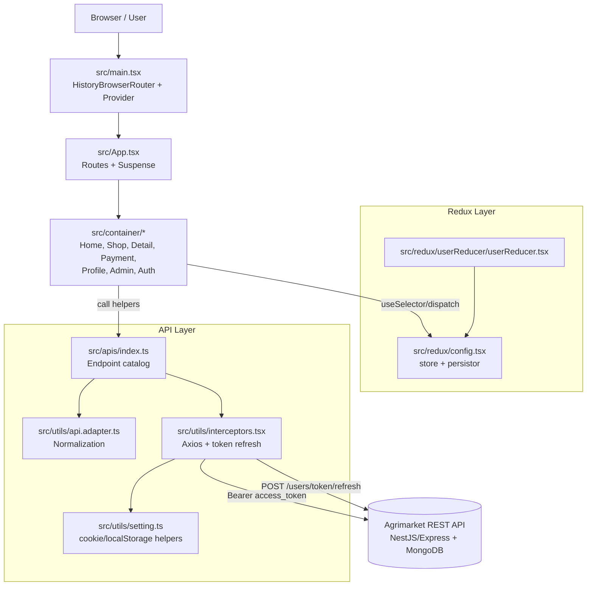

# WORK.md — Tài liệu kỹ thuật Agrimarket Frontend

> Tài liệu chuẩn cho dự án **Agrimarket** (sàn thương mại điện tử nông sản sạch).
> Viết bằng tiếng Việt, giữ nguyên thuật ngữ kỹ thuật tiếng Anh.
> Mọi nội dung dưới đây dựa trên **source code thực tế** của repository, không phải giả định.

---

## Mục lục (Table of Contents)

| # | Nội dung | File |
|---|----------|------|
| 0 | Tổng quan dự án & hướng dẫn đọc | [WORK.md](#0-tổng-quan-dự-project) |
| 1 | Kiến trúc dự án (Part 7) | [WORK.md](#1-kiến-trúc-dự-project) |
| 2 | Tài liệu chức năng chi tiết (Part 8) | [docs/10-features.md](docs/10-features.md) |
| 3 | Tích hợp API & xác thực (Part 3) | [docs/04-api-integration.md](docs/04-api-integration.md) |
| 4 | Roadmap JavaScript (Part 9) | [docs/01-javascript-roadmap.md](docs/01-javascript-roadmap.md) |
| 5 | Roadmap TypeScript (Part 10) | [docs/02-typescript-roadmap.md](docs/02-typescript-roadmap.md) |
| 6 | React & Next.js (Part 11) | [docs/03-react-nextjs.md](docs/03-react-nextjs.md) |
| 7 | Tối ưu code (Part 12) | [docs/05-optimization.md](docs/05-optimization.md) |
| 8 | Giải quyết vấn đề thực tế (Part 13) | [docs/06-problem-solving.md](docs/06-problem-solving.md) |
| 9 | Chuẩn bị phỏng vấn (Part 14) | [docs/07-interview-questions.md](docs/07-interview-questions.md) |
| 10 | Bài tập thực hành (Part 15) | [docs/08-exercises.md](docs/08-exercises.md) |
| 11 | Lộ trình học tuần tự (Part 16) | [docs/09-learning-roadmap.md](docs/09-learning-roadmap.md) |
| 12 | Báo cáo kiểm thử & trạng thái API (Part 19) | [WORK.md](#12-báo-cáo-trạng-thái-api--kiểm-thử) |

---

## 0. Tổng quan dự án

### 0.1. Mục đích

Agrimarket là **sàn thương mại điện tử nông sản sạch (organic food e-commerce)**. Người dùng có thể:

- Xem danh mục sản phẩm theo category (rau củ, trái cây, nấm…).
- Xem chi tiết sản phẩm kèm thuộc tính (khối lượng, giá gốc, % giảm giá, chứng nhận hữu cơ…).
- Thêm sản phẩm vào giỏ hàng, cập nhật số lượng, xoá sản phẩm khỏi giỏ.
- Thanh toán (checkout) bằng cách tạo đơn hàng.
- Đăng ký / đăng nhập / xác thực OTP / quên mật khẩu / đổi mật khẩu.
- Xem & cập nhật hồ sơ cá nhân.
- Yêu thích / bỏ yêu thích sản phẩm.
- Quản trị sản phẩm (Admin): xem danh sách, xoá, sửa.

### 0.2. Business requirements (yêu cầu nghiệp vụ)

| Mã | Yêu cầu | Nơi hiện thực |
|----|----------|----------------|
| BR-01 | Người dùng chưa đăng nhập vẫn xem được danh sách & chi tiết sản phẩm | `src/components/CartProducts/CartProduct.tsx`, `src/container/Detail/page/ProductDetail/ProductDetail.tsx` |
| BR-02 | Giỏ hàng & đơn hàng chỉ dành cho user đã đăng nhập | `src/utils/interceptors.tsx` (401 → refresh → `/login`), `src/components/Cart/Cart.tsx` + `CartProduct.tsx` (chỉ gọi `getCart()` khi `isAuthenticated`) |
| BR-03 | Tài khoản phải xác thực OTP mới đăng nhập được | `POST /users/otp/authenticate` tại `src/container/Auth/pages/Verification/Verification.tsx` |
| BR-04 | Quyền Admin được phân theo `role` từ profile API | `src/container/Admin/page/Admin.tsx`, `ProductAdmin.tsx` |
| BR-05 | Mỗi sản phẩm có 1+ `product_attribute`; giá hiển thị suy ra từ attribute | `src/utils/api.adapter.ts` → `normalizeProduct` |
| BR-06 | Thêm giỏ hàng bắt buộc gửi kèm `product_attribute_id` | `src/components/Cart/Cart.tsx`, `CartProduct.tsx`, `ProductDetail.tsx` |
| BR-07 | Tìm kiếm sản phẩm theo keyword, lọc theo category | `src/components/Categories/Categories.tsx`, `src/components/CartProducts/CartProduct.tsx` |

### 0.3. Công nghệ & framework

| Lớp | Công nghệ | Phiên bản | Vai trò |
|-----|-----------|-----------|---------|
| Build | Vite | 5.1.6 | Dev server, bundling, env variables (`VITE_*`) |
| UI runtime | React | 18.2.0 | Component, hooks, concurrent rendering |
| Routing | react-router-dom | 6.23.1 | Client-side routing, `useParams`, `useSearchParams` |
| State | @reduxjs/toolkit + react-redux + redux-persist | 2.2.3 / 9.1.2 / 6.0.0 | Shared state + persist qua `localStorage` |
| UI kit | antd + @ant-design/icons | 5.15.3 | Form, Table, Modal, Badge, Rate, Countdown… |
| Styling | Tailwind CSS + SCSS | 3.4.10 / 1.72.0 | Utility-first classes + component styles |
| HTTP | axios | 1.6.8 | Interceptor, token refresh, retry |
| Feedback | react-toastify | 10.0.5 | Toast success/error |
| Chart | chart.js + react-chartjs-2 | 4.4.4 / 5.2.0 | Dashboard admin |
| Type safety | TypeScript | 5.2.2 | Toàn bộ `src/` |
| Lint | ESLint + typescript-eslint + react-hooks | 8.57 / 7.1 / 4.6 | Static analysis |

### 0.4. Hướng dẫn đọc tài liệu

- Muốn **hiểu code chạy thế nào** → đọc mục 1 và `docs/10-features.md`.
- Muốn **hiểu gọi API thế nào** → đọc `docs/04-api-integration.md`.
- Muốn **học JS/TS/React** → đọc `docs/01…03`, `docs/09-learning-roadmap.md`.
- Muốn **phỏng vấn** → đọc `docs/07-interview-questions.md`.
- Muốn **làm bài tập** → đọc `docs/08-exercises.md`.

---

## 1. Kiến trúc dự project

### 1.1. Sơ đồ tổng thể



### 1.2. Backend

Backend **không có source trong repo này** — chỉ truy cập được qua REST API và Swagger UI
(`https://agrimarket-z5f0.onrender.com/api-docs/#/`).

Quan sát được từ response headers & error envelope:

- Base URL: `https://agrimarket-z5f0.onrender.com/api/v1`
- Framework: **NestJS trên Express** (error shape `ErrorWithStatus`, field errors dạng `{ type, value, msg, path, location }` → đây là output của `class-validator` + `ValidationPipe`).
- Database: **MongoDB** (Atlas SRV — `mongodb+srv://...`), lỗi `querySrv ENOTFOUND _mongodb._tcp.fmp-database.v3wqdos.mongodb.net` khi cluster không khả dụng.
- Response envelope thành công:

```json
{
  "statusCode": 200,
  "message": "...",
  "data": {},
  "dateTime": "2026-11-10T08:37:48.206Z"
}
```

- Response envelope lỗi:

```json
{
  "message": "Validation error.",
  "errors": {
    "email": { "type": "field", "msg": "The email does not exist...", "path": "email" }
  }
}
```

> ⚠️ **Phân biệt quan trọng:** Mọi khẳng định về *implementation nội bộ* của backend trong tài liệu này đều là **quan sát từ hành vi HTTP**, không phải đọc code backend. Những chỗ không xác minh được sẽ được ghi rõ là "chưa xác minh".

### 1.3. Cấu trúc thư mục

```
.
├── index.html                  # Vite entry HTML
├── vite.config.ts              # Cấu hình Vite (@vitejs/plugin-react)
├── tailwind.config.js          # Nội dung Tailwind
├── postcss.config.js           # PostCSS cho Tailwind
├── tsconfig.json               # TypeScript config (strict)
├── scripts/
│   └── verify-integration.mjs  # Script kiểm thử endpoint sống
└── src/
    ├── main.tsx                # Root: Provider > PersistGate > HistoryBrowserRouter
    ├── App.tsx                 # Routes + Suspense (lazy loading)
    ├── index.scss              # Global styles
    │
    ├── @type/                  # TypeScript types
    │   ├── global.type.ts      # productTypes, cartTypes, profileType, apiResponseType…
    │   ├── user.type.ts        # payload types cho auth
    │   ├── button.type.ts
    │   └── form.type.ts
    │
    ├── apis/
    │   └── index.ts            # ⭐ Catalog của TOÀN BỘ endpoint
    │
    ├── utils/
    │   ├── interceptors.tsx    # ⭐ Axios instance + 401 refresh flow
    │   ├── api.adapter.ts      # ⭐ Normalization layer
    │   └── setting.ts          # cookie/localStorage helpers
    │
    ├── redux/
    │   ├── config.tsx          # store + persistReducer
    │   └── userReducer/
    │       └── userReducer.tsx # ⭐ Slice duy nhất
    │
    ├── routes/
    │   ├── routes.ts           # Bảng route + React.lazy
    │   └── index.tsx
    │
    ├── config/
    │   ├── index.tsx
    │   └── routes.ts           # Hằng số path
    │
    ├── constants/images.ts     # Ảnh nền
    │
    ├── container/              # Các trang (page-level)
    │   ├── Home/page/MainHome.tsx
    │   ├── Shop/page/Shop.tsx
    │   ├── Detail/page/ProductDetail/ProductDetail.tsx
    │   ├── Payment/Payment.tsx
    │   ├── Profile/Page/MainProfile.tsx
    │   ├── Auth/pages/{Login,Register,Verification,ForgotPassword,NewPassword,ChangePassword}
    │   └── Admin/
    │       ├── page/{Admin,HomeAdmin,ProductAdmin,EditAdmin,Stock}
    │       └── components/{Sidebar,HeaderAdmin,CategoriesChart,SalesFunnelChart}
    │
    └── components/             # Component dùng lại
        ├── HeaderItem/         # Header + avatar + cart badge + logout
        ├── SearchProduct/      # Hero banner
        ├── ProductPortfolio/   # 4 ô danh mục nổi bật
        ├── CartProducts/       # Danh sách sản phẩm (Home)
        ├── Cart/               # Danh sách sản phẩm (Shop)
        ├── Categories/         # Sidebar: search + category + price range
        ├── Myfavorite/         # Bảng sản phẩm yêu thích
        ├── Button/ButtonClick.tsx
        ├── ButtonLike/ButtonLike.tsx
        ├── BestsellerProducts/ Exotic Fruits/ Fancybox/ CarouselItem/
        ├── OurTestimonial/ Footer/ Loading/ NotFound/
```

### 1.4. Vai trò từng file trụ cột

| File | Vai trò | Ai phụ thuộc | Khi nào sửa |
|------|---------|---------------|------------|
| `src/utils/interceptors.tsx` | Tạo Axios instance, gắn `Authorization: Bearer`, xử lý 401 → refresh token → retry 1 lần, redirect `/login` khi thất bại | **Mọi** lời gọi API (trực tiếp qua `src/apis`) | Đổi base URL, thêm header, đổi chiến lược refresh |
| `src/apis/index.ts` | Nơi duy nhất biết path + method + shape của payload của từng endpoint | Mọi component | Thêm endpoint mới, đổi contract |
| `src/utils/api.adapter.ts` | Chuẩn hoá response API → shape UI (`attributes`→`productAttributes`, `carts`→`items`, `full_name`→`fullName`) | `src/apis/index.ts` | Khi backend đổi shape |
| `src/utils/setting.ts` | Wrapper `localStorage` / `document.cookie` | `interceptors.tsx`, các trang Auth | Thêm key storage mới |
| `src/redux/userReducer/userReducer.tsx` | Toàn bộ shared state của user + sản phẩm + cart + category + favorite | Toàn bộ component dùng `useSelector` | Thêm state/action mới |
| `src/redux/config.tsx` | Tạo store, bật `redux-persist` | `main.tsx` | Đổi cấu hình persist |
| `src/routes/routes.ts` | Khai báo path + `React.lazy` cho từng trang | `App.tsx` | Thêm trang mới |
| `src/config/routes.ts` | Hằng số path (dùng để tránh magic string) | `routes.ts`, component khác | Thêm path |
| `src/@type/global.type.ts` | Shape của product/cart/profile/category + envelope API | Toàn bộ | Mở rộng type |
| `src/@type/user.type.ts` | Payload type cho register/login/cart/profile | `src/apis/index.ts` | Mở rộng payload |
| `scripts/verify-integration.mjs` | Chạy 16 assertion trên API sống | CI/manual | Thêm endpoint mới vào danh sách |

### 1.5. Cấu hình môi trường

| Biến | Bắt buộc | Mặc định / ghi chú |
|------|----------|-------------------|
| `VITE_API_URL` | Không | Fallback: `https://agrimarket-z5f0.onrender.com/api/v1`. Dùng để trỏ về backend local. |
| `VITE_OTP_LENGTH` | Có (logic) | Dùng ở `Verification.tsx` để validate độ dài OTP. Nếu thiếu → `Number(undefined)` = `NaN` → so sánh luôn false → **không bao giờ submit được**. Phải set (thường là `6`). |

> 🔐 `.env` đã được thêm vào `.gitignore` (commit `128b37c`) và file `.env` cũ đã được `git rm --cached` — **không còn token/credential nào trong lịch sử commit mới**.

### 1.6. Frontend ↔ Backend communication

Toàn bộ đi qua **một** entry point duy nhất:

```
Component
  → src/apis/index.ts (login, getCart, createOrder…)   // business-friendly helper
    → src/utils/api.adapter.ts (normalize)               // đổi shape API → shape UI
      → requestApi() trong src/utils/interceptors.tsx    // gắn token, xử lý 401
        → axios → https://agrimarket-z5f0.onrender.com/api/v1/<path>
```

**Quy ước bắt buộc khi thêm endpoint mới:**

1. Thêm helper vào `src/apis/index.ts` — **không** gọi `axios` trực tiếp từ component.
2. Nếu response lệch shape → xử lý trong `src/utils/api.adapter.ts`, không sửa JSX.
3. Path đặt trong `src/config/routes.ts` nếu là route; endpoint thì viết literal trong `src/apis`.
4. Không hardcode token; không log token ra console.

### 1.7. Authentication & Authorization

**Luồng đăng nhập** (`src/container/Auth/pages/Login/Login.tsx`):

```
POST /users/login  { email, password }
  → response.data = { access_token, refresh_token, role, _id, email }
    → setStore(ACCESS_TOKEN, access_token)      // localStorage
    → setCookie(REFRESH_TOKEN, refresh_token, 7) // cookie 7 ngày
    → dispatch(setAuthenticationStatus(true))
    → dispatch(setAdminStatus(role === "Admin"))
    → navigate("/")
```

**Refresh token** (`src/utils/interceptors.tsx`):

```
Request bất kỳ → 401 Unauthorized
  → nếu request chưa retry (_retried) → gọi POST /users/token/refresh { refresh_token }
    → thành công: lưu token mới, gửi lại request gốc
    → thất bại: clearTokens() + window.location.href = "/login"
```

> **Dedupe:** `refreshAccessToken()` dùng chung một promise (`refreshPromise`) → nhiều request 401 đồng thời chỉ gọi refresh **1 lần**, tránh refresh token bị rotate nhiều lần làm hỏng session.

**Phân quyền Admin:** `GET /users/@me/profile` trả `role`. `Admin.tsx` và `ProductAdmin.tsx` so sánh `role === "Admin"`, nếu không phải Admin → `navigate("*")` (trang 404).

> ⚠️ **Hạn chế đã biết (không sửa trong phạm vi task này):** việc kiểm tra role diễn ra ở client. `Admin.tsx` dùng `navigate()` **trong render body** — đây là anti-pattern của React (side-effect trong render). Nên dùng `<Navigate to="*" replace />` trong JSX hoặc guard ở tầng route.

### 1.8. State management

Một **slice duy nhất**: `userReducer`.

| State | Kiểu | Ý nghĩa |
|-------|------|---------|
| `login`, `register`, `verify` | `userType \| null` | Response của các API auth |
| `loading` | `boolean` | Cờ loading toàn cục |
| `isAuthenticated` | `boolean` | Đã đăng nhập chưa |
| `isAdmin` | `boolean` | Có phải Admin không |
| `email` | `string \| null` | Email đang chờ verify OTP |
| `isForgotPassword` | `boolean` | Đang ở flow quên mật khẩu (quyết định endpoint verify nào dùng) |
| `product` | `productTypes[]` | Danh sách sản phẩm (đã normalize) |
| `cart` | `cartTypes \| null` | Giỏ hàng hiện tại |
| `profile` | `profileType \| null` | Hồ sơ user |
| `cartnumber` | `number` | Badge số lượng trên icon giỏ |
| `category` | `CategoryType[]` | Danh mục |
| `favorite` | `FavoriteType[]` | Sản phẩm yêu thích |
| `supplier` | `SupplierType[]` | Nhà cung cấp |

**Persist:** `redux-persist` với `storage = localStorage`, `key = "root"`. Nghĩa là **token cũng nằm trong localStorage** và tồn tại qua các lần reload.

> ⚠️ **Hạn chế đã biết:** `redux-persist` chưa `blacklist` `isAuthenticated` / `isAdmin`. Khi user đăng xuất, `setAuthenticationStatus(false)` được dispatch nhưng store đã persist — lần reload sau state có thể bị kéo lại từ storage. `HeaderItem.tsx` có gọi `clearTokens()` khi logout nhưng **không** `persistor.purge()`.

### 1.9. Routing

| Path | Component | Auth? |
|------|-----------|-------|
| `/` | `MainHome` | không |
| `/shop` | `Shop` | không |
| `/product/:productId` | `ProductDetail` | không |
| `/login` | `Login` | không |
| `/register` | `Register` | không |
| `/verification` | `Verification` | không |
| `/forgot-password` | `ForgotPassword` | không |
| `/new-password` | `NewPassword` | không |
| `/changepassword` | `ChangePassword` | không (nhưng cần token) |
| `/profile` | `MainProfile` | có (check trong component) |
| `/payment` | `PayMent` | có (qua API 401) |
| `/myfavorite` | `Myfavorite` | có (qua API 401) |
| `/admin`, `/productadmin`, `/stock`, `/editadmin/:editId` | Admin pages | Admin (check `role`) |
| `*` | `NotFound` | không |

Tất cả đều **lazy** qua `React.lazy` + `Suspense fallback={<Loading />}` trong `App.tsx` → code-splitting theo route.

### 1.10. Error handling

| Tầng | Cơ chế |
|------|---------|
| Network/HTTP | `requestApi` trả `Promise.reject(err)` với `AxiosError` |
| 401 | Interceptor thử refresh 1 lần, nếu thất bại → clear token + `/login` |
| Component | `try/catch` + `getApiErrorMessage(error, fallback)` từ `src/utils/api.adapter.ts` → `toast.error(...)` |
| Form | Ant Design `Form.Item rules` validate phía client trước khi submit |
| Loading | `toast.loading(...)` + `toast.update(...)` ở `MainProfile.tsx`, `EditAdmin.tsx` |

`getApiErrorMessage` xử lý 3 dạng: `data.message` (string) → `errors[field].msg` → `error.message` → fallback.

---

## 12. Báo cáo trạng thái API & kiểm thử

### 12.1. Kiểm thử tự động

```bash
node scripts/verify-integration.mjs
```

Script gọi đúng URL + payload mà `src/apis/index.ts` sinh ra, rồi kiểm tra shape response có khớp với cách component đọc hay không.

**Kết quả thực tế (2026-11-10):**

| Nhóm | Kết quả |
|------|---------|
| Public endpoints (products, products/:id, categories, products/categories/:id, suppliers, products/search) | ✅ PASS (6/6) |
| Shape assertion (`productAttributes[]`, `category.name`, giá suy ra, `attribute` ở detail, `products[]` ở search) | ✅ PASS (6/6) |
| Authenticated endpoints (profile, carts, likes, orders, logout) | ❌ FAIL — do **backend** chặn, không phải do frontend |
| `POST /users/register` | ❌ 500 `{"message":"Failed to send OTP"}` — backend không gửi được email OTP (SMTP chưa cấu hình / hết quota) |

### 12.2. Phân loại trạng thái endpoint

| Endpoint | Method | Trạng thái | Ghi chú |
|----------|--------|------------|--------|
| `/users/register` | POST | 🔴 BLOCKED_BY_BACKEND | 500 "Failed to send OTP" |
| `/users/login` | POST | 🟡 PARTIAL | Trả 400 "Account is unverified" cho account mới — **đúng flow** (cần verify OTP trước) |
| `/users/logout` | POST | 🟡 UNVERIFIED | Cần access token hợp lệ |
| `/users/token/refresh` | POST | 🟡 UNVERIFIED | Cần refresh token hợp lệ |
| `/users/@me/profile` | GET/PUT | 🟡 UNVERIFIED | Cần access token |
| `/users/password/change` | POST | 🟡 UNVERIFIED | Cần access token |
| `/users/password/forgot` | POST | 🟡 UNVERIFIED | |
| `/users/password/forgot/authenticate` | POST | 🟡 UNVERIFIED | |
| `/users/password/reset` | POST | 🟡 UNVERIFIED | |
| `/users/otp/authenticate` | POST | 🟡 UNVERIFIED | |
| `/users/otp/revalidate` | POST | 🟡 UNVERIFIED | |
| `/products` | GET | 🟢 VERIFIED | 200 |
| `/products/:id` | GET | 🟢 VERIFIED | 200, trả `attribute` (số ít) |
| `/products/categories/:categoryId` | GET | 🟢 VERIFIED | 200 |
| `/products/search?keyword=` | POST | 🟢 VERIFIED | 200 |
| `/products/:id/like` | POST | 🟡 UNVERIFIED | Cần token |
| `/products/:id/unlike` | POST | 🟡 UNVERIFIED | Cần token |
| `/products/:id` | PUT | 🟡 UNVERIFIED | Admin |
| `/products?id=` | DELETE | 🟡 UNVERIFIED | Admin |
| `/users/products/favorites` | GET | 🟡 UNVERIFIED | Cần token |
| `/categories` | GET | 🟢 VERIFIED | 200 |
| `/suppliers` | GET | 🟢 VERIFIED | 200 |
| `/carts` | GET | 🟡 UNVERIFIED | Cần token |
| `/carts/items` | POST | 🟡 UNVERIFIED | Cần token |
| `/carts/items/:cartId` | PUT/DELETE | 🟡 UNVERIFIED | Cần token |
| `/orders` | GET/POST | 🟡 UNVERIFIED | Cần token |

**Giải thích vì sao authenticated endpoints FAIL trong script:** script tạo user mới → backend gửi OTP thất bại (`500`) → user chưa verify → không có `access_token` → mọi request có `Authorization` đều trả `401 {"message":"You must be logged in to continue."}`. Đây là **hành vi đúng** của backend, không phải bug frontend.

### 12.3. Kiểm tra chất lượng code

| Kiểm tra | Lệnh | Kết quả |
|----------|------|---------|
| TypeScript | `npx tsc --noEmit` | ✅ **PASS** — 0 error |
| ESLint | `npx eslint . --ext ts,tsx` | ⚠️ 54 problems (39 error, 15 warning) — **phần lớn là code cũ** (`no-var`, `no-explicit-any` trong `utils/setting.ts`, `main.tsx`, các trang Auth…). Không sửa vì ngoài phạm vi integration và sửa sẽ là rewrite. Tầng API mới (`src/apis`, `src/utils/api.adapter.ts`, `src/@type`) đã lint **sạch 0 lỗi**. |
| Build | `npm run build` | ✅ **PASS** — `tsc && vite build` thành công |
| Regression | So sánh `git diff` từng file | ✅ Không thay đổi UI/UX, không đổi tên biến/hàm/type, không thêm dependency |

### 12.4. Danh sách file đã thay đổi

| File | Thay đổi | Lý do |
|------|----------|-------|
| `.gitignore` | thêm `.env` | Chặn commit secret |
| `src/utils/interceptors.tsx` | base URL từ env; bỏ header CORS sai; thêm 401 refresh flow | Yêu cầu Part 3.3 |
| `src/utils/api.adapter.ts` (mới) | `normalizeProduct(s)`, `normalizeCart`, `normalizeProfile`, `getApiErrorMessage` | Mapping layer Part 3.2 |
| `src/apis/index.ts` (mới) | 30 helper endpoint | Endpoint catalog Part 2.3 |
| `src/@type/global.type.ts` | thêm `apiResponseType`, `apiErrorType`, `ProductImageType`, mở rộng `ProductAttribute` | Type theo API thật |
| `src/@type/user.type.ts` | `loginPayloadType`, `registerPayloadType`, `addToCartPayloadType`, `updateProfilePayloadType` | Type payload |
| `src/container/Auth/pages/Login/Login.tsx` | `auth/login`→`users/login`, field `email`, lưu token | Endpoint sai |
| `src/container/Auth/pages/Register/Register.tsx` | `auth/signup`→`users/register`, map snake_case | Endpoint sai |
| `src/container/Auth/pages/ChangePassword/ChangePassword.tsx` | `auth/changepassword`→`users/password/change` | Endpoint sai |
| `src/container/Auth/pages/ForgotPassword/ForgotPassword.tsx` | →`users/password/forgot` | Endpoint sai |
| `src/container/Auth/pages/NewPassword/NewPassword.tsx` | →`users/password/reset` | Endpoint sai |
| `src/container/Auth/pages/Verification/Verification.tsx` | thêm `authenticateForgotPassword`, `authenticateOtp`, `resendOtp` | Chưa tích hợp |
| `src/components/HeaderItem/HeaderItem.tsx` | `auth/me`→`users/@me/profile`; logout gọi API | Endpoint sai |
| `src/container/Profile/Page/MainProfile.tsx` | GET/PUT `users/@me/profile`, map snake_case | Endpoint sai |
| `src/components/CartProducts/CartProduct.tsx` | thêm `product_attribute_id`; cart count từ `items.length` | 400 Bad Request |
| `src/components/Cart/Cart.tsx` | POST `carts/items` kèm attribute id | 404 |
| `src/container/Payment/Payment.tsx` | `removeCartItem`, `updateCartItems`, `createOrder` | Chưa tích hợp |
| `src/container/Detail/page/ProductDetail/ProductDetail.tsx` | gọi `getProductById(productId)` | Deep-link 404 |
| `src/components/Categories/Categories.tsx` | `searchProducts(keywords)`; bỏ `useEffect` sai lệch trong handler | Chưa tích hợp + bug |
| `src/components/Myfavorite/Myfavorite.tsx` | `getFavoriteProducts()` | Chưa tích hợp |
| `src/container/Admin/page/Admin.tsx` | `getMyProfile`, `getProducts`, `deleteProduct` | URL cứng |
| `src/container/Admin/page/ProductAdmin/ProductAdmin.tsx` | API helpers; `getSuppliers()` chuyển vào `useEffect` | URL cứng + infinite loop |
| `src/container/Admin/page/EditAdmin/EditAdmin.tsx` | `getProductById`, `updateProduct` | Chưa tích hợp |
| `scripts/verify-integration.mjs` (mới) | 32 assertion | Xác minh Part 3.4 |
| `src/container/Detail/page/ProductDetail/ProductDetail.tsx` | thêm `loading` state, `<Loading />` / `<NotFound />` thay cho `navigate("*")` trong render; guard `productAttributes`/`category` | Tránh 404 nháy + crash khi thiếu attribute |
| `src/container/Admin/page/Admin.tsx` | thêm `profileChecked` → chỉ redirect 404 sau khi đã load profile | Không redirect oan lúc đang xác thực role |
| `src/container/Admin/page/ProductAdmin/ProductAdmin.tsx` | thêm `profileChecked` tương tự | Như trên |

---

## 13. Vấn đề còn lại (Known issues)

| # | Vấn đề | Mức độ | Vị trí |
|---|--------|--------|--------|
| 1 | Backend không gửi được email OTP → `POST /users/register` trả 500, không tạo được tài khoản mới để test auth flow | 🔴 Cao | Backend (`Failed to send OTP`) |
| 2 | Swagger UI yêu cầu Basic Auth, `SWAGGER_USERNAME`/`SWAGGER_PASSWORD` không có trong env → không đọc được spec chính thức | 🟡 Trung bình | Hạ tầng tài liệu |
| 3 | ~~`navigate()` gọi trong render body (side-effect trong render) ở `Admin.tsx`, `ProductAdmin.tsx`, `ProductDetail.tsx`~~ → **Đã xử lý**: `ProductDetail.tsx` dùng `<Loading />` / `<NotFound />`; `Admin.tsx` + `ProductAdmin.tsx` chỉ redirect sau khi đã load profile (`profileChecked`) | ✅ Đã sửa | `ProductDetail.tsx`, `Admin.tsx`, `ProductAdmin.tsx` |
| 4 | `redux-persist` không purge khi logout → state `isAuthenticated` có thể bị rehydrate | 🟡 Trung bình | `src/redux/config.tsx` |
| 5 | `src/components/Categories/Categories.tsx` còn filter "Price"/"Additional" chỉ là UI tĩnh, chưa nối API | 🟢 Thấp | Business requirement chưa có endpoint tương ứng |
| 6 | ~~`ProductDetail.tsx` render `detail.productAttributes.map(...)` mà không guard~~ → **Đã xử lý**: dùng `(detail.productAttributes ?? []).map(...)` và `detail.category?.name` | ✅ Đã sửa | `ProductDetail.tsx` |
| 7 | `HeaderItem.tsx` hiển thị `isprofile?.username` nhưng API trả `full_name`/`email` → tên hiển thị trống | 🟢 Thấp | Đã có `fullName` trong adapter |
| 8 | Không có phân trang (pagination) — `GET /products` trả toàn bộ danh sách | 🟢 Thấp | Backend không trả metadata page |
| 9 | 39 ESLint error còn lại đến từ code cũ (`no-var`, `no-explicit-any`) | 🟢 Thấp | Ngoài phạm vi task; tầng API mới lint sạch |
| 10 | `Payment.tsx` dùng `key={index}` cho list → React khuyến nghị key ổn định | 🟢 Thấp | |
| 11 | ~~`Myfavorite.tsx` gọi `getFavoriteProducts()` khi khách chưa đăng nhập~~ | ✅ **Đã xử lý**: guard bằng `isAuthenticated` |
| 12 | Chưa có `Error Boundary` quanh `<Routes>` → lỗi render làm sập cả cây component | 🟢 Thấp | Đề xuất trong `docs/04-api-integration.md` § 8 |

---

## 14. Câu hỏi phỏng vấn nhanh (tham chiếu)

Chi tiết đầy đủ tại [`docs/07-interview-questions.md`](docs/07-interview-questions.md).

1. **Kiến trúc dự án này thế nào?** → Vite + React 18 SPA, React Router v6, Redux Toolkit + redux-persist, Ant Design 5 + Tailwind, Axios qua 1 interceptor.
2. **Frontend giao tiếp backend ra sao?** → `src/apis/index.ts` → `api.adapter.ts` → `interceptors.tsx` → axios.
3. **Login hoạt động thế nào?** → `POST /users/login`, lưu access token vào localStorage, refresh token vào cookie.
4. **Access token được xử lý ra sao?** → request interceptor gắn header; response interceptor 401 → refresh → retry 1 lần → fail thì clear + `/login`.
5. **Phân biệt Admin và User?** → `GET /users/@me/profile` → `role === "Admin"` → `setAdminStatus`.
6. **API response khác interface TS thì làm gì?** → Adapter layer `normalizeProduct/normalizeCart/normalizeProfile` giữ nguyên JSX.
7. **Debug 401?** → Kiểm tra token trong localStorage, cookie refresh token, Network tab xem request nào fail, thử `POST /users/token/refresh` tay.

---

## 15. Quy trình làm việc khuyến nghị

```bash
# 1. Cài deps
npm install

# 2. Tạo .env.local (KHÔNG commit)
#    VITE_API_URL=https://agrimarket-z5f0.onrender.com/api/v1
#    VITE_OTP_LENGTH=6

# 3. Chạy dev
npm run dev

# 4. Kiểm tra chất lượng
npx tsc --noEmit
npx eslint . --ext ts,tsx
npm run build

# 5. Kiểm thử API sống
node scripts/verify-integration.mjs
```

### Nguyên tắc khi đóng góp

1. **Một endpoint = một helper** trong `src/apis/index.ts`.
2. **Không** gọi `axios`/`fetch` trực tiếp trong component.
3. **Không** sửa shape response tại chỗ sử dụng — sửa ở adapter.
4. **Không** thêm dependency mới nếu không thật sự cần.
5. **Không** commit `.env`, token, credential.
6. Commit theo Conventional Commits, mỗi 15 file thay đổi một commit.
