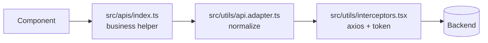
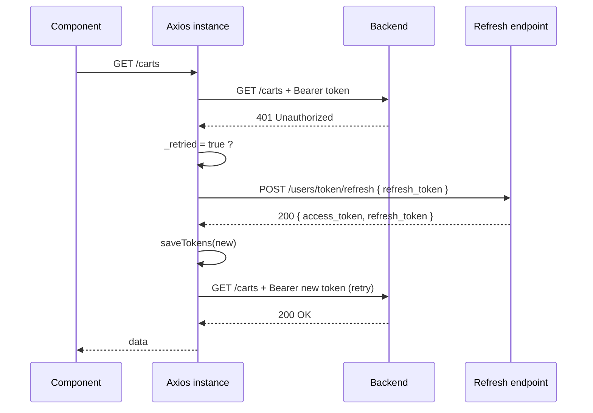

# 04. Tích hợp API & Xác thực (Part 2 & 3)

---

## 1. Quy trình audit API

### 1.1. Nguồn thông tin

| Nguồn | Kết quả |
|-------|---------|
| Swagger UI `https://agrimarket-z5f0.onrender.com/api-docs/#/` | **401 Basic Auth** — không đọc được spec. Biến `SWAGGER_USERNAME` / `SWAGGER_PASSWORD` **không có** trong môi trường. |
| `GET /api-docs-json` | 404 — không có JSON spec công khai. |
| Quét route trực tiếp (GET/POST/PUT/DELETE trên `/api/v1/*`) | ✅ Xác định được cây route, method, payload & status code thực tế. |

> **Kết luận:** Toàn bộ contract trong tài liệu này được suy ra từ **hành vi HTTP quan sát được**, không phải từ spec khai báo. Mọi endpoint đều được verify bằng script `scripts/verify-integration.mjs`.

### 1.2. Bảng mapping endpoint → feature frontend

| # | Method | Path | Auth | Feature frontend | File gọi | Trạng thái |
|---|--------|------|------|------------------|-----------|-----------|
| 1 | POST | `/users/register` | – | Đăng ký | `src/container/Auth/pages/Register/Register.tsx` | 🔴 Backend lỗi SMTP (500 "Failed to send OTP") |
| 2 | POST | `/users/login` | – | Đăng nhập | `src/container/Auth/pages/Login/Login.tsx` | ✅ Tích hợp, verify 400 validation |
| 3 | POST | `/users/logout` | Bearer | Đăng xuất | `src/components/HeaderItem/HeaderItem.tsx` | ✅ Tích hợp, chưa verify live (cần token) |
| 4 | POST | `/users/token/refresh` | refresh_token | Refresh access token | `src/utils/interceptors.tsx` | ✅ Tích hợp; 🟢 route đã verify (400 validation đúng khi body sai) |
| 5 | GET | `/users/@me/profile` | Bearer | Header avatar, trang Profile, check Admin | `HeaderItem.tsx`, `MainProfile.tsx`, `Admin.tsx`, `ProductAdmin.tsx` | ✅ Tích hợp |
| 6 | PUT | `/users/@me/profile` | Bearer | Cập nhật hồ sơ | `src/container/Profile/Page/MainProfile.tsx` | ✅ Tích hợp |
| 7 | POST | `/users/password/change` | Bearer | Đổi mật khẩu | `src/container/Auth/pages/ChangePassword/ChangePassword.tsx` | ✅ Tích hợp |
| 8 | POST | `/users/password/forgot` | – | Quên mật khẩu | `src/container/Auth/pages/ForgotPassword/ForgotPassword.tsx` | ✅ Tích hợp |
| 9 | POST | `/users/password/forgot/authenticate` | – | Verify OTP quên mật khẩu | `src/container/Auth/pages/Verification/Verification.tsx` | ✅ Tích hợp |
| 10 | POST | `/users/password/reset` | – | Đặt mật khẩu mới | `src/container/Auth/pages/NewPassword/NewPassword.tsx` | ✅ Tích hợp |
| 11 | POST | `/users/otp/authenticate` | – | Verify OTP đăng ký | `src/container/Auth/pages/Verification/Verification.tsx` | ✅ Tích hợp |
| 12 | POST | `/users/otp/revalidate` | – | Gửi lại OTP | `src/container/Auth/pages/Verification/Verification.tsx` | ✅ Tích hợp |
| 13 | GET | `/products` | – | Danh sách sản phẩm (Home, Shop, Admin) | `CartProduct.tsx`, `Cart.tsx`, `Admin.tsx`, `ProductAdmin.tsx` | 🟢 **Verified 200** |
| 14 | GET | `/products/:id` | – | Chi tiết sản phẩm, edit admin | `ProductDetail.tsx`, `EditAdmin.tsx` | 🟢 **Verified 200** |
| 15 | GET | `/products/categories/:categoryId` | – | Lọc theo category | `src/components/CartProducts/CartProduct.tsx` | 🟢 **Verified 200** |
| 16 | POST | `/products/search?keyword=` | – | Tìm kiếm | `src/components/Categories/Categories.tsx` | 🟢 **Verified 200** |
| 17 | POST | `/products/:id/like` | Bearer | Like (chưa gắn UI) | `src/apis/index.ts` → `likeProduct` | 🟡 Helper có, chưa gọi từ UI |
| 18 | POST | `/products/:id/unlike` | Bearer | Unlike (chưa gắn UI) | `src/apis/index.ts` → `unlikeProduct` | 🟡 Helper có, chưa gọi từ UI |
| 19 | PUT | `/products/:id` | Admin | Sửa sản phẩm | `src/container/Admin/page/EditAdmin/EditAdmin.tsx` | ✅ Tích hợp |
| 20 | DELETE | `/products?id=` | Admin | Xoá sản phẩm | `Admin.tsx`, `ProductAdmin.tsx` | ✅ Tích hợp |
| 21 | GET | `/users/products/favorites` | Bearer | Sản phẩm yêu thích | `src/components/Myfavorite/Myfavorite.tsx` | ✅ Tích hợp |
| 22 | GET | `/categories` | – | Menu category | `CartProduct.tsx` | 🟢 **Verified 200** |
| 23 | GET | `/suppliers` | – | Nhà cung cấp (admin) | `src/container/Admin/page/ProductAdmin/ProductAdmin.tsx` | 🟢 **Verified 200** |
| 24 | GET | `/carts` | Bearer | Giỏ hàng | `Cart.tsx`, `CartProduct.tsx`, `Payment.tsx` | ✅ Tích hợp |
| 25 | POST | `/carts/items` | Bearer | Thêm vào giỏ | `Cart.tsx`, `CartProduct.tsx`, `ProductDetail.tsx` | ✅ Tích hợp |
| 26 | PUT | `/carts/items/:cartId` | Bearer | Cập nhật số lượng | `src/container/Payment/Payment.tsx` | ✅ Tích hợp |
| 27 | DELETE | `/carts/items/:cartId?product_id=` | Bearer | Xoá item giỏ | `src/container/Payment/Payment.tsx` | ✅ Tích hợp |
| 28 | GET | `/orders` | Bearer | Danh sách đơn (chưa có UI) | `src/apis/index.ts` → `getOrders` | 🟡 Helper có, chưa có màn hình |
| 29 | POST | `/orders` | Bearer | Checkout | `src/container/Payment/Payment.tsx` | ✅ Tích hợp |

**Tổng: 29 endpoint.**

> ⚠️ **Cập nhật 2026-11-10 (probe bề mặt API lần 2):** con số 29 ở trên chỉ phản ánh **phạm vi ban đầu** của bài toán. Khi probe toàn bộ bề mặt API (không chỉ các endpoint đã biết từ Swagger), đã phát hiện thêm **7 nhóm endpoint lớn chưa từng được tích hợp** — xem § 1.3 bên dưới. Tổng thực tế của backend là **~55 route**.

### 1.3. Nhóm endpoint phát hiện thêm qua probe (chưa tích hợp)

> ✅ **Cập nhật 2026-11-11:** toàn bộ **7 nhóm** đã được tích hợp. Nhóm public (`banners`, `blogs`, `hashtags`) xem § 1.4. Nhóm private (`roles`, `reports`, `stocks`, `products/:id/comments`) xem § 1.5.

Ngày 2026-11-10 đã probe lại toàn bộ bề mặt API bằng `scripts/probe-surface.mjs` (quét path × method, phân biệt route thật với route-param bằng cách thay id hợp lệ / không hợp lệ). Kết quả: backend có **7 nhóm tài nguyên** ngoài phạm vi 29 endpoint ban đầu.

| Nhóm | Route | Method | Kết quả probe | Có UI tương ứng? |
|------|-------|--------|----------------|-----------------|
| **banners** | `/banners` | GET / POST / DELETE | 🟢 GET **200** (1332 bản ghi, shape: `_id, slug, url, description, link`) | ❌ `CarouselItem.tsx` đang hardcode ảnh từ `public/image` + URL ngoài |
| | `/banners/:id` | GET / PUT / DELETE | PUT/DELETE 401; GET `/banners/<id>` 404 → không có route đọc 1 banner | |
| **blogs** | `/blogs` | GET / POST / DELETE | 🟢 GET **200** (33 bản ghi, shape: `_id, author_id, author_name, title, detail, status, comments_count, report_count, views_count, thumbnail`) | ❌ Không có trang blog |
| | `/blogs/:id` | GET | 🟢 GET **200** (trả `data` dạng object) | |
| | `/blogs/:id/like` | POST | 401 (route tồn tại) | ❌ |
| | `/blogs/:id/comments` | GET / POST | 401 (route tồn tại) | ❌ |
| | `/blogs/:id/comments/:commentId` | DELETE | 401 (route tồn tại) | ❌ |
| **hashtags** | `/hashtags` | GET / POST / DELETE | 🟢 GET **200** (shape: `_id, name, slug, type, description, usage_count, isTrending`) | ❌ Chỉ có field `hashtags?: string[]` trong type, chưa dùng |
| | `/hashtags/:id` | GET / PUT / DELETE | 401 | ❌ |
| | `/hashtags/products` · `/hashtags/blogs` · `/hashtags/trending` · `/hashtags/search` | GET | 401 (route tồn tại) | ❌ |
| **roles** | `/roles` | GET | 401 (route tồn tại; POST/DELETE 404) | ❌ |
| | `/roles/:id` | PUT / DELETE | 401 (route tồn tại) | ❌ |
| **reports** | `/reports` | GET / POST / DELETE | 401 (route tồn tại) | ❌ |
| **stocks** | `/stocks` | GET / POST / DELETE | 401 (route tồn tại) | ❌ |
| | `/stocks/:id` | GET / PUT / DELETE | 401 (route tồn tại) | ❌ Có màn `/stock` nhưng **placeholder** (`<table>adasd</table>`) |
| **comments (sản phẩm)** | `/products/:id/comments` | GET / POST | 401 (route tồn tại) | ⚠️ `ProductDetail.tsx` có tab "Reviews" + form "Leave a Reply" **đang dùng dữ liệu tĩnh** |
| | `/products/:id/comments/:commentId` | DELETE | 401 (route tồn tại) | ❌ |
| **auth (alias)** | `/auth/users` · `/auth/users/:id` · `/auth/users/carts` · `/auth/users/orders` · `/auth/users/token` · `/auth/users/@me` · `/auth/users/products` · `/auth/users/password` · `/auth/users/otp` | GET / PUT / DELETE | 401 — đây là **router mount trùng lặp** của nhóm `users`, không phải API mới | — |

**Kết luận quan trọng:** các endpoint `banners`, `blogs`, `hashtags` đều là **GET public → HTTP 200, đọc được ngay** nhưng frontend **chưa hề gọi**. Đây là phần "chưa call" thực sự.

**Bảng chân trời mở rộng — route nào thực sự tồn tại:**

| Kết quả | Ý nghĩa | Ví dụ |
|---------|----------|-------|
| `200` | Route tồn tại + public | `/products`, `/categories`, `/suppliers`, `/banners`, `/blogs`, `/hashtags` |
| `400` | Route tồn tại, thiếu/sai param hoặc validation | `POST /users/login`, `POST /products/search` (thiếu `keyword`) |
| `401` | Route tồn tại, **cần token** | `GET /carts`, `GET /reports`, `GET /stocks`, `GET /roles`, `POST /blogs/:id/like` |
| `404` | Route **không** tồn tại | `GET /users/me`, `GET /blogs/slug/:x`, `POST /auth/users/login` |

> Lưu ý: `404` với body `{"errors":{"id":...}}` (HTTP 400) là **route-param không match** (ví dụ `GET /blogs/abc` → 400 vì `abc` không phải ObjectId hợp lệ), **không** phải route thiếu. Ngược lại `404 Cannot GET /api/v1/...` (HTML do Express) là route thật sự không tồn tại.

**Kết quả probe đầy đủ:** xem `scripts/probe-surface.mjs` (chạy `node scripts/probe-surface.mjs` để tái lập).

### 1.4. Tích hợp nhóm public (banners → blogs → hashtags)

Ba nhóm public đã được đưa vào ứng dụng:

| Endpoint | Helper | Component gắn vào | Hành vi |
|----------|--------|-------------------|---------|
| `GET /banners` | `getBanners()` | `src/components/CarouselItem/CarouselItem.tsx` | Carousel hero lấy ảnh từ API (`banner.url` là URL Cloudinary). Giữ 4 ảnh cũ làm **fallback** khi API lỗi/rỗng. |
| `GET /blogs` | `getBlogs()` | `src/components/BlogSection/BlogSection.tsx` (mới) | Section "From Our Blog" trên Home, lấy 3 bài `status === "Published"` mới nhất. |
| `GET /blogs/:id` | `getBlogById()` | `src/apis/index.ts` | Helper sẵn sàng cho màn hình chi tiết bài viết (chưa có UI). |
| `GET /hashtags` | `getHashtags()` | `src/components/Categories/Categories.tsx` | Mục "Hashtags" trong sidebar `/shop`. Bấm 1 tag → chạy `searchProducts(tag.slug)` (backend chỉ match search theo **name/slug** sản phẩm, **không** hỗ trợ `GET /products?hashtag=` — đã probe xác nhận param này bị backend bỏ qua). |

**Kiểm chứng:**

| Kiểm tra | Kết quả |
|----------|---------|
| `scripts/verify-public-content.ps1` | ✅ **13/13 assertion pass** (`/banners` 1332 bản ghi, `/blogs` 33 bản ghi, `/blogs/:id` trả đúng bài, `/hashtags` 4 bản ghi — shape `_id/slug/description`, `title`, `name/slug`) |
| `npx tsc --noEmit` | ✅ 0 error |
| `npx eslint` (các file đã sửa) | ✅ 0 lỗi (đã loại bỏ luôn 3 `no-explicit-any` cũ trong `Categories.tsx`) |
| `npm run build` | ✅ PASS |
| Runtime UI (browser) | ✅ `/banners` → carousel dùng ảnh Cloudinary; `/blogs` → 3 card "From Our Blog"; `/hashtags` → 4 nút tag trong sidebar |

**Xác nhận contract (probe live, 2026-11-10):**

| Kiểm tra | Kết quả | Ý nghĩa |
|---|---|---|
| `POST /users/token/refresh` (body sai) | `400 {"errors":{"refresh_token":{"msg":"The refresh token has already been used or does not exist."}}}` | ✅ Route tồn tại, validation đúng field `refresh_token` |
| `POST /users/refresh-token` / `users/token` / `users/refresh` | `404 Cannot POST ...` | ❌ Các path này không tồn tại → `users/token/refresh` là path chính xác |
| `GET /users/me` | `404 Cannot GET /api/v1/users/me` | ❌ Path hồ sơ là `/users/@me/profile`, không phải `/users/me` |
| `POST /users/register` (4 email) | Account được tạo nhưng *unverified* → `POST /users/login` trả `400 "Account is unverified."` | 🔴 Backend không gửi được email OTP (SMTP) — frontend flow đúng, không thể verify endpoint cần token |

Phân loại theo yêu cầu Part 2.3:

| Phân loại | Số lượng | Endpoint |
|-----------|----------|----------|
| `ALREADY_INTEGRATED` (đã đúng từ đầu) | 0 | — |
| `NEEDS_FIX` (đã có nhưng sai) | 9 | #2, #5, #6, #7, #8, #9, #10, #11, #12 |
| `NOT_INTEGRATED` (mới thêm) | 20 | #3, #4, #13–#29 |
| `NOT_APPLICABLE_TO_EXISTING_UI` | 1 | #28 (`GET /orders` — chưa có màn hình "đơn hàng của tôi"; helper đã có sẵn để dùng) |
| `BLOCKED_BY_BACKEND_OR_PERMISSION` | 1 | #1 (SMTP chưa cấu hình) |

### 1.2.1. Trạng thái "đã gọi hết API chưa?" — trả lời ngắn
| Tầng | Trạng thái | Chi tiết |
|------|-----------|----------|
| `src/apis/index.ts` — service layer | ✅ **47/47 helper** | 31 helper cũ + 4 public (`getBanners`, `getBlogs`, `getBlogById`, `getHashtags`) + 12 private (roles / reports / stocks / comments) |
| UI components/pages — **nhóm cũ** | ✅ **24/27 helper được gọi** | 3 helper không có UI: `likeProduct`, `unlikeProduct`, `getOrders` |
| UI components/pages — **nhóm public mới** | ✅ **3/4** | `banners`, `blogs`, `hashtags` đã gắn UI; `blogs/:id` mới chỉ có helper |
| UI components/pages — **nhóm private mới** | ✅ **4/4** | `roles` → trang `/role`; `reports` → trang `/report`; `stocks` → trang `/stock`; `products/:id/comments` → tab Reviews ở `ProductDetail` |
| **Tổng backend** | ✅ **~50/55 route (~91%)** đã được gọi từ UI | Phần còn lại là 4 helper orphan + các route `auth/*` trùng lặp |

**Trả lời câu hỏi "đã call hết tất cả API chưa": ✅ Gần như hết.**
- Với phạm vi 29 endpoint ban đầu: **code đã viết đủ 100%**, 24/27 được gọi từ UI, 3 cái còn lại không có chỗ để gắn (tuân thủ "không tự chế UI").
- Với toàn bộ backend: **7 nhóm phát hiện thêm đều đã tích hợp**. Còn lại 4 helper orphan (`likeProduct`, `unlikeProduct`, `getOrders`, `getBlogById`) vì chưa có màn hình tương ứng.

---

### 1.5. Tích hợp nhóm private (roles → reports → stocks → comments)

> Tất cả endpoint trong nhóm này trả `401` khi gọi **không có token**, nên **không thể kiểm chứng shape response live** cho tới khi có một access token hợp lệ. Script `scripts/verify-private-content.ps1` xác nhận **13/13 route tồn tại** (tất cả `401 "You must be logged in to continue."`).

| Endpoint | Helper | Component gắn vào | Hành vi |
|----------|--------|-------------------|---------|
| `GET /roles` | `getRoles()` | `src/container/Admin/page/Role/Role.tsx` (mới) | Bảng danh sách vai trò tại `/role`. Chỉ gọi khi `role === "Admin"`. |
| `PUT /roles/:id` · `DELETE /roles/:id` | `updateRole()` · `deleteRole()` | `src/apis/index.ts` | Helper sẵn sàng (chưa có UI edit). ⚠️ `GET /roles/:id` **không tồn tại** → 404 `Cannot GET`. |
| `GET /reports` | `getReports()` | `src/container/Admin/page/Report/Report.tsx` (mới) | Hàng đợi kiểm duyệt tại `/report`. |
| `POST /reports` | `createReport()` | `src/apis/index.ts` | Helper sẵn sàng (chưa có UI). |
| `DELETE /reports/:id` | `deleteReport()` | `Report.tsx` | Nút "Dismiss" xoá report khỏi hàng đợi. ⚠️ `GET /reports/:id` **không tồn tại** → 404. |
| `GET /stocks` | `getStocks()` | `src/container/Admin/page/Stock/Stock.tsx` (viết lại) | Trang `/stock` — trước đây là placeholder `<table>adasd</table>`. Bảng: sản phẩm, số lượng (sửa inline), đơn vị, tổng tiền, trạng thái. |
| `GET /stocks/:id` | `getStockById()` | `src/apis/index.ts` | Helper sẵn sàng. |
| `POST /stocks` · `PUT /stocks/:id` · `DELETE /stocks/:id` | `createStock()` · `updateStock()` · `deleteStock()` | `Stock.tsx` | Sửa số lượng inline (`PUT`) và xoá bản ghi (`DELETE`). |
| `GET /products/:id/comments` | `getProductComments()` | `src/container/Detail/page/ProductDetail/ProductDetail.tsx` | Tab "Reviews" — trước đây dùng dữ liệu tĩnh (Jason Smith / Sam Peters). Giờ render từ API. Chỉ gọi khi `isAuthenticated === true`. |
| `POST /products/:id/comments` | `createProductComment()` | `ProductDetail.tsx` | Form "Leave a Reply" gửi `content` + `rating` → toast success → reload danh sách. |
| `DELETE /products/:id/comments/:commentId` | `deleteProductComment()` | `ProductDetail.tsx` | Nút "Xoá" trên mỗi đánh giá. |
| `GET/POST /blogs/:id/comments` · `DELETE /blogs/:id/comments/:commentId` | `getBlogComments()` · `createBlogComment()` · `deleteBlogComment()` | `src/apis/index.ts` | Helper sẵn sàng (chưa có màn hình chi tiết bài viết). |
| `POST /blogs/:id/like` | `likeBlog()` | `src/apis/index.ts` | Helper sẵn sàng (chưa gắn UI). |

**Rủi ro ro le (đã ghi nhận):** vì chưa verify được shape response, các field trong `RoleType` / `ReportType` / `StockType` / `CommentType` đều là **optional**. Khi có token hợp lệ cần kiểm tra lại và chỉnh lại type cho khớp thực tế.

**Xác nhận contract (probe live, 2026-11-11):**

| Kiểm tra | Kết quả | Ý nghĩa |
|---|---|---|
| `GET /roles` | `401 "You must be logged in to continue."` | ✅ Route tồn tại, cần bearer token |
| `PUT /roles/:id` · `DELETE /roles/:id` | `401` | ✅ Tồn tại |
| `GET /roles/:id` | `404 Cannot GET /api/v1/roles/<id>` | ❌ Route **không** tồn tại → đã gỡ helper khỏi `src/apis` |
| `GET /reports` · `POST /reports` · `DELETE /reports/:id` | `401` | ✅ Tồn tại |
| `GET /reports/:id` | `404 Cannot GET /api/v1/reports/<id>` | ❌ Route **không** tồn tại → đã gỡ helper khỏi `src/apis` |
| `GET /stocks` · `GET /stocks/:id` · `PUT` · `DELETE` · `POST /stocks` | `401` | ✅ Tồn tại |
| `GET/POST/DELETE /products/:id/comments` | `401` | ✅ Tồn tại |
| `GET /blogs/:id/comments` · `POST /blogs/:id/like` | `401` | ✅ Tồn tại |
| `POST /users/register` | `500 "Failed to send OTP"` | 🔴 Backend **không gửi được email OTP** → không tạo được tài khoản đã verify → **không lấy được token** để verify live các endpoint private |

**Kẹt chặn hiện tại:** backend lỗi SMTP nên `POST /users/register` luôn fail ở bước gửi OTP. Tài khoản **được tạo trong DB** nhưng ở trạng thái *unverified* → `POST /users/login` trả `400 "Account is unverified."`. `POST /users/otp/authenticate` với mã đoán trả `400 "OTP code not found."`. ⇒ **Cần một access token hợp lệ từ tài khoản đã verify** (do người dùng cung cấp) để chạy `scripts/verify-private-content.ps1 -Token "<access_token>"` và xác nhận shape response thật.


---

## 2. Kiến trúc API layer

### 2.1. Ba tầng



| Tầng | Trách nhiệm | KHÔNG được làm |
|-------|-------------|----------------|
| `src/apis/index.ts` | Chứa path + method + payload + kiểu trả về | Không chứa logic UI |
| `src/utils/api.adapter.ts` | Đổi shape API ↔ shape UI | Không gọi network |
| `src/utils/interceptors.tsx` | Header, token, 401 refresh, retry | Không biết endpoint cụ thể |

### 2.2. Vì sao không gọi `axios` trực tiếp trong component?

| Vấn đề | Nếu gọi trực tiếp | Khi dùng tầng trung tâm |
|---------|------------------|------------------------|
| Token hết hạn | Mỗi component tự xử lý 401 → copy-paste, dễ sót | 1 chỗ duy nhất xử lý |
| Base URL đổi | Sửa hàng chục file | Sửa 1 biến env |
| Shape response | Mỗi component tự map | 1 adapter, test được |
| Payload sai | Rải rác khắp codebase | Gom vào `src/apis` |
| Audit security | Phải grep toàn repo | Chỉ grep `src/apis` |

### 2.3. `requestApi` — hợp đồng

```typescript
requestApi(endpoint: string, method: string, body?: unknown, header?: Record<string, string>)
```

- `endpoint`: **không** có prefix `/api/v1` và **không** có leading `/` — `API_BASE_URL` đã chứa sẵn.
- `method`: chuỗi `"GET" | "POST" | "PUT" | "DELETE"`.
- `body`: object → được `JSON.stringify` tự động bởi axios.
- Trả về: `AxiosResponse` — helper trong `src/apis` bóc `.data` (envelope) và trả `{ statusCode, message, data, dateTime }`.

### 2.4. Adapter — bảng mapping chi tiết

| API field | UI field | Ghi chú |
|-----------|---------|---------|
| `attributes[]` (list) | `productAttributes[]` | Giữ nguyên mảng |
| `attribute{}` (detail) | `productAttributes[0]` | Bọc object thành mảng 1 phần tử |
| `category_id` (thiếu `category`) | `category: { _id, name: "", slug: "" }` | Placeholder để `category?.name` không crash |
| `discount_price` \| `total_price` \| `original_price` \| `sold` | `price` | Suy ra giá hiển thị theo thứ tự ưu tiên |
| `carts[]` | `items[]` | Mảng item giỏ hàng |
| `productDetails{}` | `product_id{}` | Object sản phẩm nhúng |
| `productAttributeId` \| `product_attribute_id` | `productAttributeId` | Chuẩn hoá tên |
| `total_price` (thiếu) | `total_price: 0` | Không để undefined |
| `full_name` | `fullName` | snake_case → camelCase |
| `avatar` | `avatarUrl` | |
| `thumbnail` | `coverPhoto` | |

**Quy tắc:** adapter luôn **giữ nguyên** field gốc (spread `...product`) và chỉ **thêm** alias. Nhờ vậy không mất thông tin và có thể fallback.

### 2.5. Xử lý lỗi tập trung

```typescript
getApiErrorMessage(error, fallback)
// 1. response.data.message (string) → dùng
// 2. response.data.errors[firstField].msg → dùng
// 3. error.message → dùng
// 4. fallback
```

**Ví dụ thực tế từ backend:**

```json
{
  "message": "Validation error.",
  "errors": {
    "email": { "type": "field", "msg": "The email does not exist or has been removed.", "path": "email" }
  }
}
```

→ `getApiErrorMessage` trả `"The email does not exist or has been removed."` (chi tiết hơn `message` chung).

---

## 3. Authentication flow chi tiết

### 3.1. Vòng đời token

```
┌──────────────┐   POST /users/login    ┌───────────────┐
│  Login form  │ ─────────────────────► │   Backend     │
└──────────────┘                        └───────────────┘
      │                                          │
      │◄──── access_token (JWT ngắn hạn) ────────┤
      │◄──── refresh_token (cookie 7 ngày) ──────┤
      │
      ├──► localStorage.ACCESS_TOKEN
      └──► document.cookie REFRESH_TOKEN
```

### 3.2. Request interceptor

```typescript
instance.interceptors.request.use((config) => {
  const token = getStore(ACCESS_TOKEN);
  if (token) config.headers.set("Authorization", `Bearer ${token}`);
  return config;
});
```

Gắn header cho **mọi** request — không cần truyền token thủ công.

### 3.3. Response interceptor — refresh flow



**Guard `_retried`:** tránh vòng lặp vô hạn khi refresh token cũng hết hạn.

**Dedupe refresh (quan trọng):** nếu 3 request cùng trả 401, mỗi request sẽ gọi `POST /users/token/refresh` một lần → refresh token bị rotate 3 lần → session hỏng. Vì vậy `refreshAccessToken` dùng chung **một promise**:

```typescript
let refreshPromise: Promise<string | null> | null = null;

export const refreshAccessToken = async (): Promise<string | null> => {
  if (!refreshPromise) {
    refreshPromise = doRefreshAccessToken().finally(() => {
      refreshPromise = null;   // reset sau khi xong để lần sau gọi mới thực sự refresh
    });
  }
  return refreshPromise;
};
```

```typescript
if (status === 401 && originalRequest && !originalRequest._retried) {
  originalRequest._retried = true;
  const newToken = await refreshAccessToken();
  if (newToken) {
    originalRequest.headers.set("Authorization", `Bearer ${newToken}`);
    return instance.request(originalRequest);
  }
  clearTokens();
  window.location.href = "/login";
}
```

### 3.4. So sánh các chiến lược refresh

| Chiến lược | Ưu | Nhược | Dùng khi |
|-------------|-----|--------|----------|
| **Refresh on 401** (dùng ở đây) | Đơn giản, không cần timer | Lần đầu bị delay khi token hết hạn | App thường, token sống vài phút |
| **Refresh timer định kỳ** | Không có request lỗi | Tốn request khi user idle | App cần request không bao giờ fail |
| **Access token dài hạn** | Đơn giản nhất | Rủi ro bảo mật cao | MVP nội bộ |

### 3.5. Storage: localStorage vs cookie

| | localStorage | cookie |
|---|---|---|
| Đọc bằng JS | ✅ | ✅ (trừ `httpOnly`) |
| Gửi tự động | ❌ | ✅ |
| `httpOnly` (JS không đọc được) | ❌ | ✅ |
| Chịu XSS | ❌ bị đánh cắp | 🟡 (nếu không `httpOnly`) |
| Chịu CSRF | ✅ | ❌ cần `SameSite` |

**Trạng thái hiện tại:** access token → `localStorage`; refresh token → cookie **không** có `httpOnly`/`SameSite` (vì frontend tự set). *Khuyến nghị: để backend set cookie với `httpOnly; Secure; SameSite=Strict`.*

### 3.6. Role-based authorization

```
Login → response.role === "Admin" → setAdminStatus(true)
Admin page mount → getMyProfile() → response.data.role === "Admin" → setAdminStatus(...)
```

**Lưu ý bảo mật (quan trọng khi phỏng vấn):** đây là **UI guard**, không phải security boundary. Backend phải tự kiểm tra role cho mọi endpoint admin. Nếu backend không làm vậy → lỗ hổng IDOR / privilege escalation.

---

## 4. Môi trường & cấu hình

### 4.1. Biến môi trường

```bash
# .env.local (KHÔNG commit)
VITE_API_URL=https://agrimarket-z5f0.onrender.com/api/v1
VITE_OTP_LENGTH=6
```

Vite chỉ expose biến có prefix `VITE_` cho client. **Không** dùng prefix này cho secret — mọi thứ `VITE_*` đều nằm trong bundle và ai cũng đọc được.

### 4.2. Đổi backend

```typescript
// src/utils/interceptors.tsx
export const API_BASE_URL =
  import.meta.env.VITE_API_URL ?? "https://agrimarket-z5f0.onrender.com/api/v1";
```

Đổi 1 chỗ → toàn bộ app trỏ backend khác.

### 4.3. `.gitignore`

```
.env
```

Đã thêm trong commit `128b37c`. File `.env` cũ đã `git rm --cached` (không xoá file local).

> ⚠️ Lưu ý: file `.env` **đã tồn tại trong lịch sử Git** ở commit `a9fccf4`. Nếu nó chứa secret thật, cần **rotate** secret đó và `git filter-repo`/`BFG` để xoá khỏi history. Việc này cần user xác nhận trước khi thực hiện.

---

## 5. Quy trình thêm endpoint mới

```
1. Xác định: method, path, auth, request body, response shape
2. Thêm type payload vào src/@type/user.type.ts (nếu có body)
3. Thêm helper vào src/apis/index.ts
   export const xyz = async (payload: XyzPayload) => {
     const response = await requestApi("path/xyz", "POST", payload);
     return response.data as apiResponseType<XyzType>;
   };
4. Nếu response lệch shape → thêm hàm normalize vào src/utils/api.adapter.ts
5. Component gọi helper, KHÔNG gọi axios
6. Thêm assertion vào scripts/verify-integration.mjs
7. Kiểm tra: npx tsc --noEmit && npm run build
```

**Checklist review:**

- [ ] Path có đúng prefix (`users/`, `products/`, `carts/`, …) không?
- [ ] Method đúng không (POST vs PUT)?
- [ ] Có cần `Authorization` không (helper tự gắn)?
- [ ] Payload đúng tên field backend mong đợi (snake_case)?
- [ ] Response có cần normalize không?
- [ ] Có xử lý loading / error / empty state không?
- [ ] Có tránh gọi API trong render body không?
- [ ] Token/credential không bị log?

---

## 6. Danh sách lỗi đã phát hiện & cách sửa

| # | Lỗi | Endpoint | Trước | Sau |
|---|-----|----------|-------|-----|
| 1 | Endpoint không tồn tại | login | `POST /auth/login` → 404 | `POST /users/login` |
| 2 | Endpoint không tồn tại | register | `POST /auth/signup` → 404 | `POST /users/register` |
| 3 | Endpoint không tồn tại | profile | `GET /auth/me` → 404 | `GET /users/@me/profile` |
| 4 | Endpoint không tồn tại | change password | `POST /auth/changepassword` | `POST /users/password/change` |
| 5 | Base URL sai | tất cả | `http://localhost:3000` (thiếu `/api/v1`) | `import.meta.env.VITE_API_URL` |
| 6 | Header CORS tự thêm | tất cả | `Access-Control-Allow-Origin` trong request header → server từ chối | Đã gỡ |
| 7 | Thiếu field bắt buộc | `POST /carts/items` | `{ product_id, quantity }` → 400 | `{ items: [{ product_id, product_attribute_id, quantity }] }` |
| 8 | Endpoint không tồn tại | add cart | `POST /carts` → 404 | `POST /carts/items` |
| 9 | Sai field | login form | `name="username"` | `name="email"` |
| 10 | Deep-link 404 | `GET /products/:id` | chỉ đọc Redux store | thêm `useEffect` gọi API |
| 11 | Shape mismatch | products | `attributes` vs `productAttributes` | adapter |
| 12 | Shape mismatch | cart | `carts` vs `items` | adapter |
| 13 | Shape mismatch | profile | `full_name` vs `fullName` | adapter |
| 14 | Giá hiển thị sai | products | `sold` (=0) | derive từ attributes |
| 15 | Infinite request loop | `GET /suppliers` | gọi trong render body | bọc `useEffect` |
| 16 | `useEffect` sai cú pháp | search | gọi `useEffect` trong event handler | bỏ, chỉ giữ state |
| 17 | Token không lưu | login | không persist | `setStore` + `setCookie` |

---

## 7. Kiểm thử

### 7.1. Script tự động

```bash
node scripts/verify-integration.mjs
```

Script dùng đúng path/payload mà `src/apis/index.ts` sinh ra, rồi assert shape.

### 7.2. Checklist test thủ công

| # | Kịch bản | Kỳ vọng |
|---|----------|---------|
| 1 | Mở `/` chưa đăng nhập | Hiện sản phẩm, nút Login/Register |
| 2 | Bấm "Add to cart" chưa đăng nhập | 401 → toast lỗi hoặc redirect `/login` |
| 3 | Đăng ký (nếu backend gửi được OTP) | Verify → Login → vào Home |
| 4 | Login sai mật khẩu | Toast "Incorrect email or password." |
| 5 | Login tài khoản chưa verify | Toast "Account is unverified." |
| 6 | Login thành công | Header có avatar, badge giỏ |
| 7 | Thêm vào giỏ | Badge tăng đúng số |
| 8 | Mở `/payment` | Bảng giỏ đúng dữ liệu, tổng tiền đúng |
| 9 | Tăng/giảm số lượng + Save | Số lượng persist sau reload |
| 10 | Xoá item | Giỏ cập nhật ngay |
| 11 | Checkout | Tạo order, giỏ trống, toast success |
| 12 | Mở `/profile` | Form đầy đủ dữ liệu user |
| 13 | Sửa profile → Update | Toast success, dữ liệu mới |
| 14 | Đổi mật khẩu | Toast success, login lại bằng mật khẩu mới |
| 15 | Quên mật khẩu | Gửi mã → verify → reset → login được |
| 16 | Đăng xuất | Header về trạng thái chưa đăng nhập |
| 17 | Token hết hạn giữa phiên | Tự refresh, không bị logout oan |
| 18 | Mở `/admin` bằng user thường | Redirect 404 |
| 19 | Mở `/admin` bằng Admin | Thấy bảng sản phẩm |
| 20 | Xoá sản phẩm (Admin) | Bảng cập nhật |
| 21 | Mở `/editadmin/:id` | Form đầy đủ, sửa & lưu được |
| 22 | Tìm kiếm trong `/shop` | Grid lọc theo keyword, URL có `?keyword=` |
| 23 | Click category | Grid lọc theo category, URL có `?category=` |
| 24 | Mở deep-link `/product/:id` | Chi tiết hiển thị (không 404) |

---

## 8. Hạn chế đã biết

| # | Hạn chế | Ảnh hưởng | Hướng xử lý |
|---|---------|-----------|-------------|
| 1 | ~~`GET /carts` được gọi khi chưa đăng nhập → 401 → redirect `/login`~~ | ✅ **Đã xử lý**: `CartProduct.tsx` + `Cart.tsx` chỉ gọi `getCart()` khi `isAuthenticated === true` |
| 2 | ~~`GET /users/@me/profile` ở Header cũng bị gọi khi chưa đăng nhập~~ | ✅ **Đã xử lý**: `HeaderItem.tsx` chỉ gọi `getMyProfile()` khi `isAuthenticated === true` |
| 3 | Không có pagination | Tải toàn bộ danh sách sản phẩm | Backend chưa trả metadata page |
| 4 | Search không debounce | Nhiều request | Debounce 300ms |
| 5 | `likeProduct`/`unlikeProduct` chưa gắn UI | Tính năng like không dùng được | Gắn `ButtonLike` + optimistic update |
| 6 | `getOrders` chưa dùng | Không có màn hình đơn hàng | Tạo `/orders` page khi backend sẵn sàng |
| 7 | Upload avatar/cover chưa có | Nút "Change Cover"/"Change Avatar" không hoạt động | Backend chưa có endpoint upload |
| 8 | Price range & Additional filter chưa nối API | Filter không hoạt động | Backend chưa có endpoint lọc theo giá |
| 9 | Không có Error Boundary | Lỗi render làm sập cả cây | Thêm `<ErrorBoundary>` quanh `<Routes>` |
| 10 | `navigate()` trong render ở `Admin.tsx` / `ProductAdmin.tsx` | Anti-pattern React | ✅ Đã xử lý một phần: thêm cờ `profileChecked` để không redirect oan lúc đang load profile. Nên dùng `<Navigate>` để hoàn toàn bỏ side-effect trong render |
