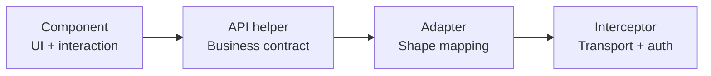

# 05. Tối ưu code (Part 12)

> Nguyên tắc: **tối ưu có mục đích**. Mỗi khuyến nghị đều kèm "khi nào KHÔNG nên dùng".

---

## Mục lục

- [12.1 Code quality](#121-code-quality)
- [12.2 Frontend performance](#122-frontend-performance)
- [12.3 API optimization](#123-api-optimization)
- [12.4 Backend & database](#124-backend--database)
- [12.5 Security](#125-security)

---

# 12.1 Code quality

## 1. Clean Code

Code dễ đọc = code dễ sửa = code ít bug.

**Dấu hiệu code bẩn:**

| Dấu hiệu | Ví dụ trong dự án (đã sửa) |
|-----------|---------------------------|
| Magic number/string | `"users/login"` rải rác khắp component |
| Comment thừa | `// set loading` khi tên hàm đã nói lên điều đó |
| Hàm quá dài | Component 400 dòng làm nhiều việc |
| Biến tên không đủ nghĩa | `data`, `temp`, `x` |
| Dead code | `console.log(userData)` còn sót trong `EditAdmin.tsx` |
| Nested if sâu | if trong if trong for |

## 2. DRY (Don't Repeat Yourself)

**Áp dụng trong task này:** trước đây mỗi component tự viết URL + token + error handling. Sau khi tách `src/apis/index.ts` + `api.adapter.ts` → **1 nguồn sự thật**.

**Ví dụ cụ thể — trước & sau:**

```typescript
// ❌ Trước: lặp ở 3 file
const respone = await axios.get("http://localhost:3000/products");
dispatch(setProduct(respone.data.data));
const res2 = await axios.get("http://localhost:3000/categories");
dispatch(setCategory(res2.data.data));

// ✅ Sau: 1 lần định nghĩa, dùng ở mọi nơi
const [products, categories] = await Promise.all([
  getProducts(),
  getCategories(),
]);
dispatch(setProduct(products.data));
dispatch(setCategory(categories.data));
```

**Cảnh báo:** DRY quá mức tạo **abstraction sai**. 3 dòng giống nhau ở 2 chỗ thì **không** cần abstract. Rule of three.

## 3. KISS (Keep It Simple, Stupid)

**Áp dụng:** không tạo `useApi` hook tổng quát chỉ vì "sẽ cần sau". Ở task này chỉ tạo abstraction khi thực sự có ≥ 3 chỗ dùng.

```typescript
// ✅ Đơn giản, đủ dùng
export const getApiErrorMessage = (error: unknown, fallback = "...") => { ... };
```

## 4. SOLID

| Nguyên tắc | Áp dụng trong dự án |
|------------|---------------------|
| **S**ingle Responsibility | `api.adapter.ts` chỉ lo chuẩn hoá; `interceptors.tsx` chỉ lo HTTP/auth |
| **O**pen/Closed | Thêm endpoint mới chỉ cần thêm helper, không sửa file cũ |
| **L**iskov Substitution | Không áp dụng rõ (không có inheritance) |
| **I**nterface Segregation | `requestApi` có 4 param nhưng dùng 3 — OK vì optional |
| **D**ependency Inversion | Component phụ thuộc vào `src/apis` (abstraction), không phụ thuộc `axios` |

## 5. Separation of Concerns



Mỗi tầng 1 trách nhiệm. Component **không** biết URL. Adapter **không** biết network.

## 6. Single Responsibility Principle

**Ví dụ tích cực trong task này — `normalizeCart`:**

```typescript
export const normalizeCart = <T extends LooseRecord>(cart: T) => {
  if (!cart) return cart;
  const rawCarts = Array.isArray(cart.carts) ? cart.carts : [];
  const items = rawCarts.map((rawItem) => {
    const item = rawItem as LooseRecord;
    return {
      ...item,
      product_id: (item.productDetails ?? item.product_id ?? {}) as LooseRecord,
      productAttributeId: (item.productAttributeId ?? item.product_attribute_id) as string | undefined,
      quantity: item.quantity as number,
      price: item.price as number | undefined,
    };
  });
  return { ...cart, items, carts: items, total_price: (cart.total_price as number) ?? 0 };
};
```

Hàm thuần, không side-effect, test được chỉ với 1 input.

## 7. Reusability

**Ví dụ:** `getApiErrorMessage` được dùng ở 8+ file → viết 1 lần.

## 8. Maintainability

Tính đo bằng: **thêm 1 endpoint mới cần bao nhiêu thay đổi?**

| Trước | Sau |
|-------|-----|
| Sửa URL ở N file, thêm `Authorization` ở N file, map shape ở N file | Thêm 1 helper trong `src/apis/index.ts` (+ adapter nếu cần) |

## 9. Readability

```typescript
// ❌ Khó đọc
const x = products.filter(p => p.category?.slug === slug).map(p => p.productAttributes[0]._id).filter(Boolean);

// ✅ Dễ đọc
const attributeIds = products
  .filter((p) => p.category?.slug === slug)
  .map((p) => p.productAttributes?.[0]?._id)
  .filter(Boolean);
```

## 10. Naming conventions

| Loại | Quy ước | Ví dụ |
|------|----------|-------|
| Component | PascalCase | `CartProduct`, `MainProfile` |
| Hook | `use` + PascalCase | `useEffect`, `useSelector` |
| Hàm | camelCase, động từ | `getProducts`, `normalizeCart` |
| Hằng số | UPPER_SNAKE | `ACCESS_TOKEN`, `API_BASE_URL` |
| Type/Interface | PascalCase | `productTypes`, `apiResponseType` |
| Biến | camelCase | `cartnumber`, `productAttributes` |
| File component | PascalCase | `CartProduct.tsx` |
| File index | `index.tsx` | re-export |

> Lưu ý: dự án dùng `productTypes` (số nhiều + `Types`) — không chuẩn TS (`ProductType` là chuẩn hơn) nhưng **giữ nguyên** theo yêu cầu bảo toàn.

## 11. Function decomposition

```typescript
// ❌ 1 hàm làm 5 việc
const buttonAdd = async (product_id) => {
  const target = product.find(...);
  const attributeId = target?.productAttributes?.[0]?._id;
  if (!attributeId) { toast.error(...); return; }
  await addToCart({...});
  const respones = await getCart();
  dispatch(setcartnumber(...));
  toast.success(...);
};

// ✅ Tách
const findAttributeId = (productId: string) =>
  product.find((item) => item._id === productId)?.productAttributes?.[0]?._id;

const refreshCartCount = async () => {
  const response = await getCart();
  dispatch(setcartnumber(response.data.items.length));
};

const buttonAdd = async (product_id: string) => {
  const attributeId = findAttributeId(product_id);
  if (!attributeId) {
    toast.error("Sản phẩm không có thuộc tính để thêm vào giỏ hàng");
    return;
  }
  try {
    await addToCart({ items: [{ product_id, product_attribute_id: attributeId, quantity: 1 }] });
    await refreshCartCount();
    toast.success("add product successfully");
  } catch (error) {
    console.log(error);
  }
};
```

---

# 12.2 Frontend performance

## 1. Tránh re-render không cần thiết

**Vấn đề:** `useSelector` trả về object/array mới mỗi lần → so sánh tham chiếu luôn khác → re-render.

```typescript
// ❌ Re-render mỗi khi bất kỳ field nào của user đổi
const user = useSelector((state: RootState) => state.user);

// ✅ Chỉ re-render khi cartnumber đổi
const cartnumber = useSelector((state: RootState) => state.user.cartnumber);
```

**Áp dụng:** `HeaderItem.tsx` đã dùng selector hẹp — ✅.

**Quan trọng:** Redux Toolkit dùng Immer → `state.user` là object mới mỗi lần có action → selector trả cả object sẽ re-render mọi action. **Luôn selector tới field cụ thể.**

## 2. `React.memo`

```typescript
const ProductCard = React.memo(({ product }: ProductCardProps) => { ... });
```

**Khi nào dùng:** component nặng (render nhiều element, tính toán) + props ổn định.

**Khi nào KHÔNG dùng:**
- Component nhẹ → overhead của `memo` > lợi ích.
- Props thay đổi mỗi render (`{...obj}` inline, `.filter()` inline) → memo vô dụng.

> Trong dự án, danh sách sản phẩm ≤ 8 item → **chưa cần** `memo`. Đây là quyết định đúng, không phải thiếu sót.

## 3. `useMemo`

```typescript
const filteredProducts = useMemo(
  () => products.filter((p) => p.category?.slug === slug),
  [products, slug]
);
```

**Khi nào dùng:** phép tính tốn (sort, filter trên 1000+ items) hoặc tạo object/array truyền cho component `memo`.

**Khi nào KHÔNG dùng:** phép tính rẻ. `products.slice(0, 8)` trên 8 phần tử → không đáng.

## 4. `useCallback`

```typescript
const handleAdd = useCallback((id: string) => { ... }, [dispatch]);
```

**Khi nào dùng:** truyền cho `memo` component, hoặc là dep của `useEffect`.

**Khi nào KHÔNG dùng:** "để tối ưu" chung. Không có lợi ích gì.

## 5. Lazy loading

```typescript
// src/routes/routes.ts — ĐÃ ÁP DỤNG
const MainHome = React.lazy(() => import("../container/Home/page/MainHome"));
const ProductDetail = React.lazy(() => import("../container/Detail/page/ProductDetail/ProductDetail"));
// ... 16 lazy routes
```

**Hiệu quả:** mỗi route là 1 chunk riêng → user chỉ tải chunk cần dùng.

**Đo lường:** kiểm tra Network tab khi mở `/` — chỉ nên tải chunk của Home + shared vendor.

## 6. Dynamic imports

```typescript
// Chỉ tải chart khi vào trang admin
const SalesFunnelChart = lazy(() => import("../components/SalesFunnelChart/SalesFunnelChart"));
```

**Áp dụng:** `chart.js` khá nặng (~200KB) → nên lazy trong `src/container/Admin/`.

## 7. Code splitting

Đã áp dụng qua `React.lazy`. Có thể tách thêm:
- `antd` — dùng `import { Button } from "antd"` (đã có tree-shaking) thay vì `import "antd"`.
- `chart.js` — lazy.
- `@fancyapps/ui` — chỉ dùng ở 1 chỗ → lazy.

## 8. Image optimization

```typescript
// ❌ Hiện tại


// ✅ Tốt hơn

```

| Kỹ thuật | Tác dụng |
|-----------|----------|
| `loading="lazy"` | Chỉ tải ảnh khi sắp vào viewport |
| `decoding="async"` | Giải mã không block main thread |
| `width`/`height` | Chống layout shift (CLS) |
| `alt` | SEO + accessibility |
| `srcset` / `<picture>` | Chọn ảnh phù hợp kích thước màn hình |

## 9. Bundle size

```bash
npm run build
# xem output Vite: kích thước từng chunk
```

**Nguyên tắc:** theo dõi sau mỗi thêm dependency.

## 10. List rendering & keys

```typescript
// ❌
{renderlist.map((cart, index) => <tr key={index}>)}

// ✅
{renderlist.map((cart) => <tr key={cart.product_id._id}>)}
```

**Tác động:** với key theo index, khi xoá phần tử đầu, React reuse component của phần tử cũ cho phần tử mới → hiển thị sai state (ví dụ số lượng bị lệch).

## 11. Pagination thay vì load tất cả

```typescript
// ❌ Hiện tại: GET /products trả toàn bộ
const products = await getProducts();

// ✅ Nếu backend hỗ trợ
const page = searchParams.get("page") ?? "1";
const products = await getProducts({ page, limit: 20 });
```

**Hiện trạng:** backend chưa hỗ trợ pagination metadata → chưa thể làm. Đã ghi nhận trong `WORK.md` § 13.

## 12. Debouncing search

```typescript
// src/components/Categories/Categories.tsx — đề xuất
const searchProductsDebounced = useMemo(
  () =>
    debounce((keyword: string) => {
      searchProducts(keyword)
        .then((res) => dispatch(setProduct(res.data)))
        .catch(console.error);
    }, 300),
  [dispatch]
);

const handleSeachChange = (event: any) => {
  const keywords = event.target.value;
  setSearchTerm(keywords);
  setSearchParams((p) => { p.set("keyword", keywords); return p; });
  searchProductsDebounced(keywords);
};
```

## 13. Caching API responses

**Hiện trạng — request trùng lặp:**

| Trang | Request | Gọi ở |
|-------|---------|--------|
| Home | `GET /products` | `CartProduct.tsx` |
| Home | `GET /categories` | `CartProduct.tsx` |
| Home | `GET /carts` | `CartProduct.tsx` **+** `Cart.tsx` → **2 lần** |
| Header | `GET /users/@me/profile` | `HeaderItem.tsx` (mọi page) |
| Admin | `GET /products` | `Admin.tsx` **+** `ProductAdmin.tsx` |

**Giải pháp 1 (đơn giản):** cache trong module.

```typescript
// src/utils/api.adapter.ts hoặc file riêng
let cartCache: cartTypes | null = null;
let cartPromise: Promise<cartTypes> | null = null;

export const getCartCached = async () => {
  if (cartCache) return cartCache;
  if (!cartPromise) {
    cartPromise = getCart().then((r) => {
      cartCache = r.data;
      return r.data;
    }).finally(() => { cartPromise = null; });
  }
  return cartPromise;
};

export const invalidateCartCache = () => { cartCache = null; };
```

**Giải pháp 2 (chuyên nghiệp):** React Query / TanStack Query.

```typescript
const { data: cart } = useQuery({ queryKey: ["cart"], queryFn: getCart });
```

Tự dedupe, cache, revalidate, retry, stale-while-revalidate.

> **Chưa áp dụng** — thêm dependency mới bị cấm trong phạm vi task ("DO NOT introduce unnecessary dependencies"). Đề xuất được ghi lại đây.

## 14. State management optimization

```typescript
// ❌ Lưu derived state vào Redux
setProductCount(products.length);   // phải cập nhật mỗi khi products đổi

// ✅ Tính trực tiếp khi render
const count = useSelector((s) => s.user.product.length);
```

**Áp dụng:** `cartnumber` đang lưu trong Redux dù có thể tính từ `state.user.cart.items.length`. Nhưng `state.user.cart` chỉ được set ở trang Payment → Header cần giữ riêng → giữ lại là hợp lý. *Đây là lý do hợp lý để giữ `cartnumber`.*

## 15. Error Boundary

```typescript
// src/App.tsx — đề xuất
<ErrorBoundary>
  <Suspense fallback={<Loading />}>
    <Routes>...</Routes>
  </Suspense>
</ErrorBoundary>
```

**Tác dụng:** 1 component lỗi không làm sập toàn bộ app.

---

# 12.3 API optimization

## 1. Giảm request không cần thiết

| Kỹ thuật | Ví dụ |
|-----------|-------|
| Chỉ gọi khi cần | `getCart()` chỉ khi `isAuthenticated` |
| Dedupe request đồng thời | `getCart()` từ 2 component → 1 request |
| Cache theo TTL | categories hầu như không đổi → cache 5 phút |
| Batch API | 1 endpoint trả nhiều dữ liệu |

**Áp dụng ngay (không thêm dependency):**

```typescript
// src/components/CartProducts/CartProduct.tsx
const isAuthenticated = useSelector((state: RootState) => state.user.isAuthenticated);

useEffect(() => {
  if (!isAuthenticated) return;      // ✅ không gọi API khi chưa đăng nhập
  const fetchCart = async () => {
    try {
      const response = await getCart();
      dispatch(setcartnumber(response.data.items.length));
    } catch (error) { console.log(error); }
  };
  fetchCart();
}, [isAuthenticated]);
```

## 2. Concurrent requests — `Promise.all`

```typescript
// ❌ Tuần tự — tổng thời gian = t1 + t2 + t3
const products = await getProducts();
const categories = await getCategories();
const cart = await getCart();

// ✅ Song song — tổng thời gian ≈ max(t1, t2, t3)
const [products, categories, cart] = await Promise.all([
  getProducts(),
  getCategories(),
  getCart(),
]);
```

**Áp dụng:** `CartProduct.tsx` hiện gọi 3 API tuần tự qua 3 `useEffect` riêng → nên gộp.

## 3. `Promise.allSettled`

```typescript
// Khi 1 request fail không nên làm hỏng tất cả
const [products, cart] = await Promise.allSettled([getProducts(), getCart()]);

if (products.status === "fulfilled") dispatch(setProduct(products.value.data));
if (cart.status === "fulfilled") dispatch(setcartnumber(cart.value.data.items.length));
// Nếu cart fail (401) → vẫn hiện được danh sách sản phẩm
```

**Đây là cải tiến quan trọng cho trang Home**: hiện tại `getCart()` fail → interceptor redirect `/login` → user mất trang chủ.

## 4. Request cancellation — `AbortController`

```typescript
useEffect(() => {
  const controller = new AbortController();

  const fetchProducts = async () => {
    try {
      const response = await getProducts({ signal: controller.signal });
      dispatch(setProduct(response.data));
    } catch (error: any) {
      if (error.name === "AbortError") return;   // bị huỷ → bỏ qua
      console.error(error);
    }
  };
  fetchProducts();

  return () => controller.abort();
}, []);
```

**Áp dụng:** `ProductDetail.tsx` nếu user đổi sản phẩm nhanh → request cũ có thể về sau.

## 5. Request caching

Xem § 12.2 #13.

## 6. Retry strategies

```typescript
// Retry có backoff — chỉ cho lỗi mạng/5xx, KHÔNG retry 4xx
const retry = async (fn, attempts = 3, delay = 1000) => {
  for (let i = 0; i < attempts; i++) {
    try {
      return await fn();
    } catch (error: any) {
      const status = error?.response?.status;
      if (status && status < 500) throw error;   // 4xx → không retry
      if (i === attempts - 1) throw error;
      await new Promise((r) => setTimeout(r, delay * 2 ** i));  // exponential backoff
    }
  }
};
```

**Không retry trong `requestApi` hiện tại** — hợp lý, vì interceptor 401 đã xử lý riêng. Retry chung có thể gây request lặp.

## 7. Pagination

Xem § 12.2 #11.

## 8. Filtering & sorting ở đúng tầng

```typescript
// ❌ Lọc phía client trên toàn bộ dataset
const filtered = allProducts.filter((p) => p.price <= maxPrice);

// ✅ Lọc phía server
const filtered = await getProducts({ maxPrice, category, keyword });
```

**Áp dụng:** `Categories.tsx` hiện có UI "Price range" nhưng lọc client-side trên dataset đã tải → sai khi dataset lớn. Backend chưa có endpoint → giữ UI nhưng ghi chú là chưa hoạt động.

## 9. Error handling

Xem `04-api-integration.md` § 2.5.

**Nguyên tắc:**
- `try/catch` ở **ranh giới** component.
- Message lỗi lấy từ server nếu có (`getApiErrorMessage`).
- Không nuốt lỗi (`catch {}` rỗng) → luôn log hoặc toast.

## 10. Token refresh handling

Xem `04-api-integration.md` § 3.3.

**Tối ưu thêm: dedupe request refresh.**

```typescript
// Nếu 5 request cùng lúc fail 401 → chỉ gọi refresh 1 lần
let refreshPromise: Promise<string | null> | null = null;

const refreshAccessToken = async () => {
  if (!refreshPromise) {
    refreshPromise = doRefresh().finally(() => { refreshPromise = null; });
  }
  return refreshPromise;
};
```

**Hiện trạng:** mỗi request 401 sẽ gọi refresh riêng → N request refresh. Nên tối ưu.

## 11. Race condition prevention

```typescript
// ❌ Response cũ có thể ghi đè response mới
const search = async (kw: string) => {
  const res = await searchProducts(kw);
  dispatch(setProduct(res.data));   // có thể là kết quả cũ
};

// ✅ Dùng sequence number
const searchSeq = useRef(0);
const search = async (kw: string) => {
  const seq = ++searchSeq.current;
  const res = await searchProducts(kw);
  if (seq === searchSeq.current) {     // chỉ apply nếu là request mới nhất
    dispatch(setProduct(res.data));
  }
};
```

**Hoặc dùng `AbortController`** (chuẩn hơn).

---

# 12.4 Backend & database

> ⚠️ **Backend source KHÔNG trong repo này.** Phần này dựa trên **quan sát hành vi HTTP** + kiến thức chung về NestJS/MongoDB. Những điểm không xác minh được sẽ được nói rõ.

## 1. Database indexing

**Quan sát được:**
- Query filter theo `category_id`, `slug`.
- Sort theo `sold`.
- Text search theo `keyword`.

**Đề xuất index (nếu backend cho phép):**

```javascript
// products collection
db.products.createIndex({ category_id: 1 });
db.products.createIndex({ slug: 1 }, { unique: true });
db.products.createIndex({ sold: -1 });
db.products.createIndex({ name: "text" });   // hỗ trợ text search

// carts collection — truy vấn theo user
db.carts.createIndex({ user_id: 1 });
```

**Quy tắc:** index trên field hay **filter** và **sort**. Đừng index mọi thứ — index làm chậm insert/update.

## 2. Query optimization

```javascript
// ❌ N+1 query
const products = await Product.find();
for (const p of products) {
  p.category = await Category.findById(p.category_id);   // 1 query mỗi product!
}

// ✅ Populate (MongoDB)
const products = await Product.find().populate("category_id");
```

**Quan sát:** `GET /products` trả `category` đã populate (có `category.name`) → backend **đã** populate ở list endpoint.

**Lưu ý:** `GET /products/:id` trả `attribute` (số ít) → có thể là populate `attributes` với `$slice: 1` hoặc dùng `.first`.

## 3. N+1 query problem

**Áp dụng cho frontend:** khi render 20 sản phẩm, đừng gọi API detail cho từng sản phẩm. Endpoint list đã trả đủ thông tin (sau khi adapter chuẩn hoá) → 1 request là đủ.

**Đã áp dụng:** `CartProduct.tsx` chỉ gọi `GET /products` (không gọi detail cho từng item) — ✅.

## 4. Data pagination

```javascript
// Backend nên hỗ trợ
GET /products?page=1&limit=20&sort=sold&order=desc
→ { data: [...], meta: { total, page, limit, totalPages } }
```

**Hiện trạng:** `GET /products` trả toàn bộ, **không có** metadata phân trang. Đây là hạn chế cần báo backend.

## 5. Aggregation

**Dùng khi:** thống kê (doanh thu theo category, số lượng bán theo sản phẩm).

```javascript
db.orders.aggregate([
  { $match: { created_at: { $gte: startDate } } },
  { $unwind: "$items" },
  { $group: { _id: "$items.product_id", total: { $sum: "$items.quantity" } } },
  { $sort: { total: -1 } },
  { $limit: 10 },
]);
```

**Quan sát:** trang Admin có `CategoriesChart` và `SalesFunnelChart` (chart.js) — nhưng dữ liệu chart hiện **chưa** lấy từ API (không thấy endpoint thống kê). Đây là khoảng trống có thể đề xuất cho backend.

## 6. Caching

| Tầng | Ví dụ | TTL gợi ý |
|------|-------|-----------|
| Redis | product list, categories | 5–60 phút |
| In-memory (NestJS `CacheModule`) | theo instance | 1–5 phút |
| HTTP cache | `ETag` / `Cache-Control` | tuỳ dữ liệu |
| Client | TanStack Query | 30 giây – 5 phút |

**Gợi ý:** `GET /categories`, `GET /suppliers` gần như không đổi → cache dài.

## 7. Validation

**Quan sát:** backend dùng `class-validator` + `ValidationPipe` → error shape:

```json
{ "message": "Validation error.", "errors": { "email": { "type": "field", "msg": "...", "path": "email" } } }
```

**Frontend đã xử lý:** `getApiErrorMessage` đọc `errors[field].msg`.

**Đề xuất thêm:**
- `whitelist: true` + `forbidNonWhitelisted: true` trong `ValidationPipe` → chặn mass assignment.
- Validate email/phone format ở cả 2 nơi.

## 8. Authentication & authorization

**Quan sát:**
- Access token ngắn hạn + refresh token xoay vòng (rotating) → refresh trả về refresh token mới → backend lưu nhiều refresh token cho 1 user (hỗ trợ nhiều thiết bị).
- Backend trả 401 với message "You must be logged in to continue." → có guard tập trung.
- Backend trả 400 với "Account is unverified." → có check trạng thái tài khoản.

**Đề xuất:**
- Rate limit trên `/users/login`, `/users/otp/authenticate` (chống brute-force).
- Rate limit gửi OTP.
- Hash password bằng bcrypt/argon2 (không quan sát được nhưng là chuẩn).
- Kiểm tra role ở **mọi** endpoint admin (không chỉ frontend).

## 9. Efficient response structures

**Quan sát — vấn đề thiếu nhất quán:**

| Endpoint | Field attributes |
|----------|-----------------|
| `GET /products` | `attributes: ProductAttribute[]` |
| `GET /products/:id` | `attribute: ProductAttribute` (số ít) |

Điều này buộc frontend phải có adapter. **Đề xuất cho backend:** thống nhất tên field, hoặc trả **cả hai** trong giai đoạn chuyển tiếp.

---

# 12.5 Security

## 1. XSS (Cross-Site Scripting)

**Vấn đề:** chèn script độc hại vào HTML → chạy trong browser user.

**Cơ chế:** React escape tự động giá trị trong JSX → an toàn **trừ** khi dùng `dangerouslySetInnerHTML`.

```jsx
// ❌ Nguy hiểm
<div dangerouslySetInnerHTML={{ __html: product.description }} />

// ✅ An toàn
<div>{product.description}</div>
```

**Áp dụng cho Agrimarket:** dự án **không** dùng `dangerouslySetInnerHTML` → ✅ an toàn.

**Còn lại:**
- `href={userInput}` → có thể là `javascript:alert(1)`. Kiểm tra: chỉ cho phép `http(s)` / relative.
- `window.location.href = "/login"` trong interceptor → giá trị là hằng → an toàn.
- Backend trả nội dung không sanitize → vẫn an toàn nhờ React escape, nhưng nếu sau này dùng `dangerouslySetInnerHTML` thì phải sanitize (DOMPurify).

## 2. CSRF (Cross-Site Request Forgery)

**Vấn đề:** user đang đăng nhập, bị website khác kích hoạt request giả (vd: tạo order).

**Điều kiện:** trình duyệt **tự động** gửi cookie cho domain đích.

**Phòng chống:**
| Biện pháp | Cách dùng |
|-----------|-----------|
| `SameSite` cookie | `SameSite=Strict` hoặc `Lax` → cookie không gửi cross-site |
| CSRF token | Header `X-CSRF-Token` phải khớp cookie |
| Không dùng cookie cho auth | Dùng `Authorization: Bearer` → trình duyệt không tự gửi |

**Áp dụng:** access token nằm trong `localStorage` và được gửi qua header `Authorization` → **không dính CSRF**. Refresh token trong cookie → cần `SameSite`.

**Đề xuất:** set `SameSite=Lax; Secure` cho cookie refresh token.

## 3. SQL / NoSQL injection

**Vấn đề:** chèn ký tự đặc biệt vào query để thay đổi logic.

**NoSQL (MongoDB) — vector điển hình:** truyền object thay vì string vào filter:

```javascript
// ❌ Nguy hiểm — nếu dùng trực tiếp req.body.email
db.users.find({ email: { $ne: null } })   // trả về MỌI user

// ✅ Luôn ép kiểu + validate
const email = String(dto.email);
db.users.findOne({ email });
```

**Áp dụng:** `POST /products/search?keyword=` — frontend dùng `encodeURIComponent(keyword)` → an toàn về mặt URL encoding. Backend vẫn phải validate kiểu `keyword` là string.

**Đề xuất cho backend:** dùng DTO class + `ValidationPipe({ whitelist: true, forbidNonWhitelisted: true })` → chặn object injection.

## 4. Secure token handling

| Vấn đề | Trạng thái | Khuyến nghị |
|--------|-----------|-------------|
| Access token trong `localStorage` | Hiện tại | Chấp nhận được nếu không có `httpOnly`; cân nhắc memory + refresh cookie |
| Refresh token trong cookie **không** `httpOnly` | Hiện tại | Backend set `httpOnly; Secure; SameSite=Strict` |
| Token ghi log console | ✅ Không có | Tiếp tục giữ |
| Token trong URL | ✅ Không có | Không bao giờ đưa token vào query string |
| Token trong Git | ✅ Đã xoá `.env` khỏi tracking | Rotate nếu đã lộ |

**Áp dụng:** `src/utils/interceptors.tsx` không log token. `getApiErrorMessage` chỉ log message.

## 5. Environment variables

```typescript
// ✅ An toàn
export const API_BASE_URL =
  import.meta.env.VITE_API_URL ?? "https://agrimarket-z5f0.onrender.com/api/v1";
```

**Nguyên tắc:**
- `VITE_*` → **luôn public**, nằm trong bundle. Chỉ dùng cho URL, key công khai, flag.
- Secret (DB password, SMTP key, Swagger credentials) → **không bao giờ** đặt trong frontend.
- Nếu cần proxy → dùng backend làm trung gian hoặc serverless function.

**Swagger credentials:** yêu cầu "không expose qua `NEXT_PUBLIC_`" → trong Vite tương đương là **không** đặt trong `VITE_*`. Đã kiểm tra: `SWAGGER_USERNAME`/`SWAGGER_PASSWORD` không có trong môi trường → không bị expose.

## 6. Input validation

**Frontend (UX):**
```typescript
<Form.Item name="email" rules={[{ required: true, message: "Please input your Email!" }]}>
```

**Backend (security — quan trọng hơn):** `class-validator` đã thấy hoạt động.

**Áp dụng:** form frontend chỉ kiểm tra `required` → backend phải là nguồn kiểm tra cuối.

## 7. Authorization checks

**Hiện trạng:**
```typescript
// src/container/Admin/page/Admin.tsx
const [profileChecked, setProfileChecked] = useState(false);
const profile = async () => {
  const response = await getMyProfile();
  dispatch(setAdminStatus(response.data?.role === "Admin"));
  setProfileChecked(true);
};
if (profileChecked && isadmin === false) { navigate("*"); return; }
```

**Đánh giá:**
- ✅ Role lấy từ API, không hardcode → tốt hơn so sánh email.
- ❌ Kiểm tra ở **client** → không phải security boundary.
- ⚠️ `navigate()` trong render → anti-pattern (đã xử lý một phần bằng `profileChecked`).
- ✅ `profileChecked` đã giải quyết UX bug "lúc chờ API, user bị đẩy 404".

**Đề xuất:**
```tsx
// 1. Render loading cho tới khi có kết quả
if (isadmin === null) return <Loading />;
if (isadmin === false) return <Navigate to="*" replace />;

// 2. Backend PHẢI kiểm tra role cho mọi endpoint admin
```

## 8. Sensitive information exposure

| Nơi | Kiểm tra | Kết quả |
|-----|----------|---------|
| `.env` trong git | ✅ Đã `git rm --cached` + `.gitignore` | OK |
| Token trong console.log | ✅ Không có | OK |
| Token trong URL | ✅ Không có | OK |
| Credentials hardcode | ✅ Không có | OK |
| Error response leak stack trace | ⚠️ Backend trả `name: "ErrorWithStatus"` — không có stack trace | OK |
| `console.log(userData)` trong `EditAdmin.tsx` | ⚠️ Log dữ liệu form (không nhạy cảm) | Nên xoá |

**Đề xuất:** xoá `console.log` debug còn sót trong `EditAdmin.tsx` và `Admin.tsx` (`console.log(userData)`, `console.log(editId)`).

---

## Tổng hợp: bảng ưu tiên

| Ưu tiên | Hạng mục | Lý do |
|---------|----------|-------|
| 🔴 Cao | Không gọi `getCart`/`getMyProfile` khi chưa đăng nhập | Đang gây redirect sai cho khách |
| 🔴 Cao | Bỏ `navigate()` trong render | Anti-pattern React, gây bug UX |
| 🔴 Cao | Xoá `console.log` debug | Rò rỉ dữ liệu, ảnh hưởng code review |
| 🟡 Trung bình | Debounce search | Nhiều request thừa |
| 🟡 Trung bình | Dedupe `getCart` (2 lần ở Home) | Trùng request |
| 🟡 Trung bình | `Promise.allSettled` cho Home | 1 API fail không nên làm hỏng cả trang |
| 🟡 Trung bình | Guard `productAttributes` ở `ProductDetail` | Tránh crash |
| 🟡 Trung bình | Dedupe request refresh token | N request refresh khi hết hạn |
| 🟢 Thấp | `loading="lazy"` cho ảnh | Tối ưu băng thông |
| 🟢 Thấp | `React.memo` | Danh sách ≤ 8 item, chưa cần |
| 🟢 Thấp | Pagination | Backend chưa hỗ trợ |
| 🟢 Thấp | React Query / SWR | Thêm dependency — chờ phase sau |
